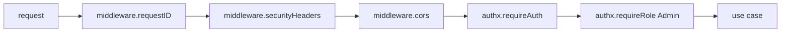
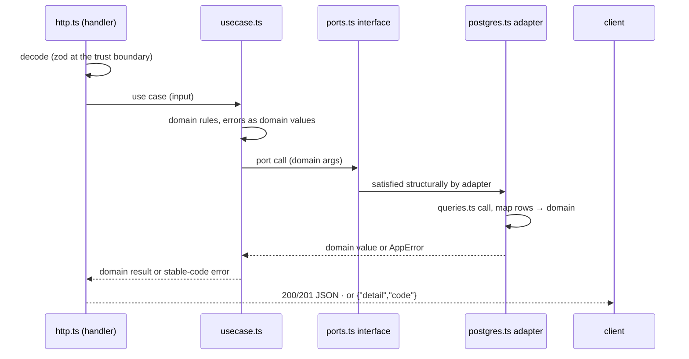

# Request Lifecycle

One request's full path through the hexagon: from Fastify's router through
the hook/preHandler chain into the identity on the request, the use case, the
port, and the adapter — plus the asides for connections that never end (WS)
or stream (SSE).

## 1. The router

Fastify's plugin-style instance matches method + `:param` routes natively —
no extra router:

```ts
app.put("/api/v1/admin/users/:id", { preHandler: [auth, role] }, h.update);
// handler-side: (req.params as { id: string }).id
```

Routes are declared in each slice's `module.ts: register*(app, Deps)`; the
composition root owns the chain around them. One mount point per slice keeps
route inventory in one readable place.

## 2. The middleware chain

Cross-cutting layers are Fastify hooks; route guards are `preHandler`
arrays ([Design Patterns §3](05-design-patterns.md)):



- `requestID` propagates an incoming `X-Request-ID` or mints one (echoed on
  the response). Fastify's built-in `requestId` generator stays; the hook is
  the echo layer.
- `securityHeaders` sets the baseline hardening headers.
- `cors` enforces the exact-origin allowlist (`<APP>_CORS_ORIGINS`, `*` in
  development only); preflight OPTIONS answers 204 without touching routes.
- `requireAuth` resolves the token — `Authorization: Bearer`, else the cookie
  when a cookie name is configured — parses it with the HS256 verifier,
  builds the `authx.Identity`, stores it as `req.identity`; failures answer
  `401` with the `{detail, code}` envelope, `AUTH_TOKEN_INVALID`.
- `requireRole(min)` then checks `rolex.atLeast(identity.role, min)`; failure
  is 403 `AUTH_FORBIDDEN`.

## 3. Identity on the request

The identity travels as a typed augmentation of the Fastify request, so
collisions are impossible and the shape is greppable:

```ts
declare module "fastify" {
  interface FastifyRequest {
    identity?: Identity;
  }
}
// requireAuth: req.identity = await verifier.parse(raw);
```

Use cases never re-parse tokens and never see `FastifyRequest` — the handler
passes the parsed input struct and (where needed) the identity fields it
declared in its own input type. That boundary is what lets the same use case
serve HTTP, a WS handshake, or a CLI.

## 4. The inward slide



Edge rules: `http.ts` validates at the trust boundary (`httpx.decode` over a
zod schema, plus required-field checks) because the domain must not trust
wire data; `domain.ts` re-checks invariants because adapters and tests may
call it directly. The request body is capped at 1 MiB by Fastify's `bodyLimit`
(`httpx.maxBodyBytes`). Error flow is strictly an `AppError` (with `cause`
wrapping where context is added) ending in `apperr` codes; the error handler
in `src/bin/api.ts` is the only place that renders HTTP status from a code —
unknown throws become 500 `INTERNAL_ERROR`.

## 5. Aside: WebSocket and SSE requests

Two endpoints do not terminate — the lifecycle diverges after `requireAuth`:

- **WS** `/api/v1/ws?token=<jwt>` — the realtime slice takes the token from
  the query, parses it directly with the verifier (browsers cannot set
  `Authorization` on `WebSocket`), and on failure closes with code **4001
  `authentication_failed`**. On success it subscribes the connection to the
  identity room on the hub, answers pings (`ws`) with pong liveness, and
  pumps each hub event as one JSON frame until the subscription ends
  ([Realtime](09-realtime-and-streaming.md)).
- **SSE** `GET /api/v1/widgets/events` — behind the normal auth chain; the
  handler writes `text/event-stream` through `reply.raw`, subscribes to the
  widgets room, and flushes per event; req socket close drives teardown.

Both stream paths must unbind their hub subscription on client disconnect —
the disconnect _is_ the cancellation — and never hold database rows while
streaming.

## 6. The worker's lifecycle (for contrast)

No request at all: `src/bin/worker.ts` builds the same config + pool and runs
two loops, both exiting on SIGTERM/SIGINT through one `AbortController`. The
email outbox loop is `runEmailWorker(outbox, sender, pollMs, batch, signal)`
with jittered backoff; the janitor loop ticks every `<APP>_JANITOR_POLL`
(default 1h) and issues idempotent DELETEs — expired-but-still-active
`sessions`, and expired `email_verifications` / `password_resets` — logging
only when it actually removed rows. Both loops never touch rotation history
or audit rows, so running one worker per deployment is safe and running two
is harmless (idempotent, replica-safe). One mental model, two entrypoints —
a single-image deploy still needs _a_ worker process, or mail and purges stop.

## 7. Aside: redirect endpoints (302, never JSON)

Two lifecycle shapes sit outside the JSON envelope rule:

- **GitHub OAuth** — `/api/v1/auth/github/login` and `/api/v1/auth/github/callback`
  answer **302** redirects (authorize URL, then the frontend success URL with
  the token pair in the fragment or the error in the query). Errors that
  browser flows would never see (provider disabled) still use the JSON
  envelope with 403.
- **WS/SSE** — §5 above; the same "the handler decides the wire shape"
  principle, just held open instead of redirected.

## See also

- [Auth Architecture](06-auth-architecture.md) — what `Identity` carries
- [Realtime & Streaming](09-realtime-and-streaming.md)
- [Errors, Config & Observability](10-error-config-observability.md) — the
  envelope mapping
