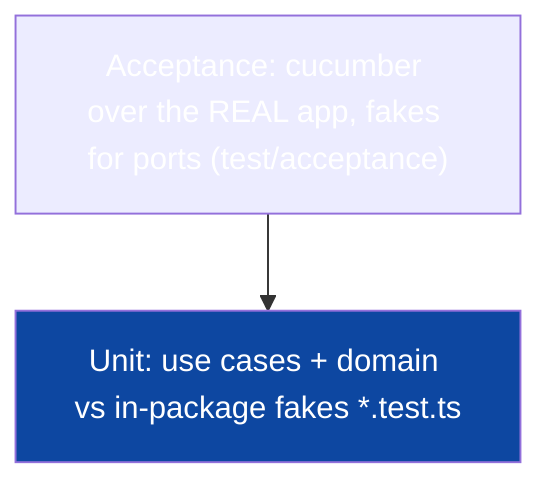

# Testing & CI

The test pyramid as this stack expresses it — unit fakes and cucumber
acceptance on a fake-wired real app — and the one gate: `make ci`.

## 1. The pyramid



| Level          | Runner                   | Database     | Speed | Catches                          |
| -------------- | ------------------------ | ------------ | ----- | -------------------------------- |
| **Unit**       | `pnpm test` (vitest)     | fakes        | ms    | business rules, envelope mapping |
| **Acceptance** | `make accept` (cucumber) | none — fakes | fast  | behavioral contracts end to end  |

The template ships no integration lane. Adapter SQL and migration
correctness are the two things the shipped tiers cannot prove; when the
project grows a schema worth protecting, add the lane deliberately (§3).

## 2. Unit: fakes, not mocks

Ports are consumer-defined interfaces
([Design Patterns §2](05-design-patterns.md)), so a fake is a class — no
mocking framework, no spy magic, no brittle `expect(...).toHaveBeenCalled`:

```ts
class FakeStore implements Store {
  saved: User | null = null;
  async insertPendingUser(u: User): Promise<void> {
    this.saved = u;
  }
}
```

Unit fakes live in the `*.test.ts` that uses them. The acceptance tier keeps
its shared doubles in `test/acceptance/fakes.ts` (`TestClock`,
`RecordedEmails`, the deterministic `nextID()`, the real HS256
minter/verifier pair — acceptance mints live tokens, it does not fake
cryptography). Table-driven cases cover branches;
vitest's `expect` diffs domain objects. Rules worth enforcing: no `time`
sleeps, no network, no wall clock — a clock is a port (`Clock` in
`#shared/clockx`), injection is one line.

## 3. Integration: a lane you add, not one that ships

The Makefile has no `test-int` target and the template has no
`@testcontainers/postgresql` dependency. That is deliberate: the shipped
suites need no Docker, so `make ci` stays an offline gate, and an empty
integration lane would be a lie with a green checkmark.

What belongs in that lane when you add it: pg adapters' mapping truth, the
`SELECT ... FOR UPDATE SKIP LOCKED` claim semantics of `email_jobs`, and the
up/down pairs in `migrations/`. Add it as a separate vitest project (or a
`*.int.test.ts` glob excluded from `make test`), boot one Postgres 17
container, apply migrations, and keep the target out of `make ci` so the
default loop stays fast and offline.

## 4. Acceptance: cucumber on the fake-wired app

`specs/features/*.feature` holds behavioral contracts; `test/acceptance/`
builds the **real** fastify app via the slices' `register(app, deps)` with
in-memory fakes (including a fake clock, a recorded mail queue, a fake Google
ID-token verifier and a fake GitHub client so both social flows run offline
with deterministic codes) — listening on an ephemeral port, then runs
cucumber:

```gherkin
Feature: signup gates
  Scenario: unverified user cannot log in
    Given an unverified user with email "a@b.co" and password "secret1!"
    When they log in
    Then the response code is 403 "AUTH_EMAIL_NOT_VERIFIED"
```

This is the proof of the composition root: `test/acceptance/app.ts` is the
second wiring of the same `register` — if a slice's `Deps` needed anything a
fake cannot provide, acceptance would fail and the architecture violated.
The features shipped with the template cover every auth slice
(`authsignup`, `authsession`, `session-mgmt`, `authpassword`, `authoauth`,
`adminusers`) plus widgets.

## 5. The gate: `make ci`

```sh
make ci   # fmt-check (prettier) + vet (tsc --noEmit) + eslint + gen-check + vitest
```

- **fmt-check** — prettier is the gofmt analog: formatting is not negotiable,
  so diffs stay content-only.
- **gen-check** — `make generate` must leave the committed `src/gen/api`
  byte-identical; stale generated code fails the gate.
- **eslint** — the `no-restricted-imports` architecture rules
  ([Dependency Rules](04-dependency-rules.md)) plus the curated
  typescript-eslint set; no `eslint-disable` escapes in the shipped code.
- **vitest** — the unit tier (feature/platform `*.test.ts`), offline, no
  docker. Dependencies are pinned to semver ranges and no lockfile is
  committed (INV-T3), so a fresh install resolves the newest in-range
  versions — commit a lockfile if you need byte-reproducible installs.

CI (`.github/workflows/ci.yml`) runs `make ci`, then `make accept`,
`pnpm audit --audit-level=high`, and actionlint. `make ci` remains the local
gate. Coverage targets behavior, not lines — the pyramid's shape is the
coverage policy.

## 6. CI hygiene

- Generated artifacts are committed (`src/gen/api`), and CI checks
  regeneration is a no-op — no generation step can hide edits.
- Caching: `actions/setup-node` with `cache: pnpm`; with no committed
  lockfile the cache key falls back to `package.json` (commit a lockfile to
  make CI caching fully effective).
- The vulnerability scan (`make vuln` / `pnpm audit`) runs as its own job —
  see [Errors, Config & Observability §5](10-error-config-observability.md).
- Concurrency surface: the hub is the one; its unit tests pin the drop/cancel
  contract. The single-threaded event loop removes the data-race class the
  sibling's race detector addresses — what remains to test is _subscription
  hygiene_ (cancel is idempotent, dropped events, closed iterators).

## Do / Don't

- **Do** test use cases through fakes first; add a cucumber scenario when the
  behavior is contract.
- **Do** keep fakes in `*.test.ts` — they are not production interfaces.
- **Don't** run Postgres in unit tests, or fake Postgres in integration
  tests — each level earns its keep at its altitude.
- **Don't** merge with red `make ci`; the lint rules encode the architecture,
  and a suppressed violation is an architecture decision taken in private.

## See also

- [Playbooks](12-playbooks.md) — test placement per change type
- [Dependency Rules](04-dependency-rules.md)
- [Realtime & Streaming](09-realtime-and-streaming.md) — the concurrency surface
