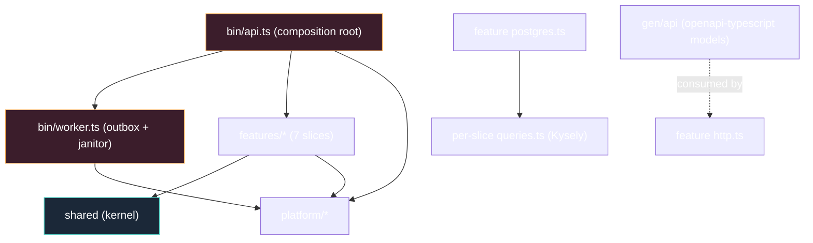

# Project Skeleton

The annotated guide to the literal `skeleton/` directory next to this `docs/`
tree. Everything is generic until `scripts/rename.sh` runs — the package name
`<app>` and the env prefix `<APP>_` are placeholders and the project cannot
install before that.

## 1. The shape you are building toward



## 2. Directory layout

```text
skeleton/
├── package.json              # name "<app>", "type": "module", engines >=24 — pinned
│                             # packageManager (corepack); subpath imports are the import law
├── Makefile                  # ci · test · accept · generate · gen-check · migrate-{up,down,add} · vuln
├── eslint.config.mjs         # flat config — no-restricted-imports architecture rules (the dependency law)
├── .env.example              # placeholder values; JWT_SECRET placeholder-guarded
├── .prettierrc.json          # gofmt analog (make fmt-check)
├── .github/workflows/        # ci.yml + deploy · docker-publish · rollback
├── migrations/               # 0001_init.mjs + 0002_profiles.mjs (up + down exports); timestamped .mjs
├── specs/                    # openapi.yaml + features/*.feature
├── docker-compose.yml        # postgres · one-shot migrations · api · worker (dev)
├── Dockerfile                # two-stage node:24-alpine, non-root runtime; healthcheck probes /healthz itself
├── test/
│   └── acceptance/           # cucumber runner + app.ts + fakes.ts (full app, no DB)
├── tsconfig.json             # strict ESM; tsconfig.test.json for the test lane
├── vitest.config.ts
└── src/
    ├── bin/
    │   ├── api.ts            # root: config → pool → platform → register* → listen (+ in-process outbox worker)
    │   ├── worker.ts         # root: config → pool → outbox loop + janitor loop (scale-out entry)
    │   └── middleware.ts     # request-id · security-headers · CORS (onRequest hooks)
    ├── features/             # authsignup · authsession · authpassword · authoauth · adminusers · widgets · realtime
    │   └── <each>            # domain.ts ports.ts queries.ts postgres.ts usecase.ts http.ts module.ts (+ *.test.ts)
    ├── platform/             # authx · oauthx · email · realtime · config · httpx · pg (transversal infra)
    ├── shared/               # apperr (stable codes) · rolex · authz · clockx · idgen — kernel only
    └── gen/                  # COMMITTED generated code (never hand-edit)
```

Conventions:

1. **The same file set per slice, always.** "Where does X live?" is answerable
   by file kind, never by grep. Tests ride alongside in `*.test.ts`.
2. **Generated code is committed** (`src/gen/**`) so builds are
   deterministic and CI needs no generator in the loop; `make generate` /
   `make gen-check` keep it honest.

## 3. `package.json` — the keystone

Package name `<app>` and description are placeholders until rename, `"type":
"module"`, `engines: { node: ">=24" }`, `packageManager` pinned for corepack.
The `"imports"` map is the dependency law's surface: `#shared/*`, `#platform/*`,
`#features/*`, `#gen/*` — own-slice files import relatively (`./x.js`),
cross-slice by subpath (and `src/features/**` bans `#features/*` outright via
eslint). Every direct dependency pinned to a modern major; versions resolve
at instantiation (`pnpm install` after `rename.sh`). INV-T3: **no
`pnpm-lock.yaml` is committed** — it cannot be generated while the package
name is a placeholder, and the lockfile is untouched by the rename, so the
pinned ranges stay valid; the `.gitignore` keeps the generated one out.

## 4. `eslint.config.mjs` — architecture as config

Flat config with file-scoped `no-restricted-imports` groups: `domain-pure`
(`features/**/domain.ts` imports no `fastify`, no `pg`/`kysely`, no
`#platform/*`, no `#gen/*`), `slice-isolation` (no `src/features/**` import
matches `#features/*`). Everything else is the curated
typescript-eslint set. See [Dependency Rules §4](04-dependency-rules.md) for
the condensed config.

## 5. Makefile

```
make ci           fmt-check + vet (tsc) + eslint + gen-check + test
make test         unit tier (vitest; no DB needed)
make accept       cucumber over test/acceptance (fake-wired app)
# no integration lane ships — see docs/11-testing-and-ci.md §3
make generate     openapi-typescript (gen-check verifies no drift)
make migrate-up / migrate-down / migrate-add NAME=
make vuln         pnpm audit --audit-level=high
make run          build + node dist/bin/api.js (set <APP>_DATABASE_URL first)
```

## 6. The composition roots

`bin/api.ts` (one function, sequential): `load()` config → fastify + cookie +
`onRequest` hooks (request-id, security headers, CORS) + error/404 envelope
handlers → `newPool` → verifier/minter + hub + cookie mode → `healthz` /
`readyz` → each slice's `register(app, deps)` → the in-process email outbox
worker on its own `AbortController` → `listen`. `SIGTERM`/`SIGINT` run
`stop()`: abort the worker, `app.close()`, `pool.end()` — graceful shutdown is
explicit, not a dangling listener. `bin/worker.ts` opens the same pool and
runs two loops on one signal — `runEmailWorker` (outbox polling) and the
janitor (`<APP>_JANITOR_POLL`, default 1h: expired sessions + stale
verification and reset codes) — same image, different entrypoint, because the
outbox deserves its own lifecycle at scale. Both roots validate config at
boot; neither applies migrations.

## 7. What ships in the box (and what does not)

Ships: seven slices (authsignup, authsession, authpassword, authoauth,
adminusers, widgets, realtime), the full auth core — passwords, Google One
Tap + GitHub social sign-in (`platform/oauthx`), session management with the
admin auth-session surface and anomalies, the `authz` self-or-subordinate
guard, outbox email, a worker janitor, WS + SSE, health gates, CI, compose
for dev (postgres + one-shot migrations + api + worker), `.claude/` agency
layer, docs tree.

Does **not** ship: billing/Stripe, a frontend, migrations-at-startup
(the compose one-shot migrations service is the deployed path),
multi-replica realtime (Redis adapter is the documented evolution), otel
(cut; seams documented). Delete the `widgets` example and your rename is
done; the rest is product-ready scaffolding.

## See also

- [Playbooks](12-playbooks.md) — the first changes you will make
- [Package Topology](03-package-topology.md)
- [Testing & CI](11-testing-and-ci.md)
