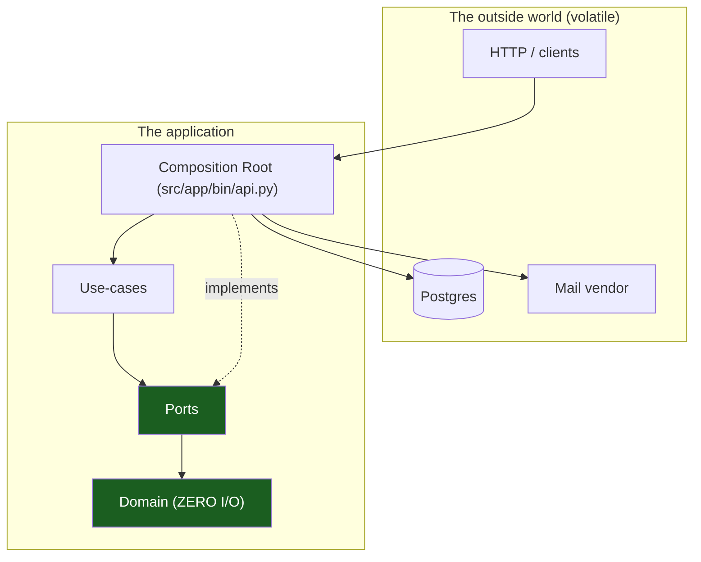
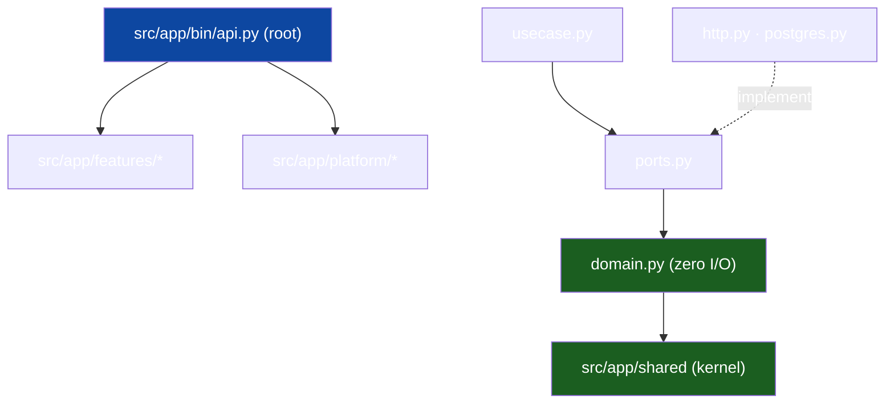

# Overview & Principles

The entry chapter. It states the one structural idea — **hexagonal (ports &
adapters) + vertical slicing, expressed as a single Python project (one
`pyproject.toml`, one import package `app`)** — and the ~8 principles that
follow. Generic; replace `<app>` with your project and `<scope>` with your
module prefix.

## 1. The problem this solves

An application accumulates two kinds of code that change for different reasons:

- **Business rules** — what the product _means_; changes when the product does.
- **Mechanisms** — how it talks to the world (DB, HTTP, mail); changes when
  infrastructure does.

If tangled, every DB swap risks the rules and every rule change risks the
wiring. The architecture keeps them apart with one discipline: **dependencies
point inward, toward the business rules, never outward toward mechanisms.** The
green nodes of the graph below never import the volatile ones.

## 2. The layers, as files

| Ring          | Where                                            | Knows about                                                | Volatility |
| ------------- | ------------------------------------------------ | ---------------------------------------------------------- | ---------- |
| **Domain**    | `src/app/features/<slice>/domain.py`             | types, IDs, enums, errors — imports `app.shared.*` only     | very low   |
| **Ports**     | `…/<slice>/ports.py`                             | `Protocol`s the use case needs                              | low        |
| **Use-cases** | `…/<slice>/usecase.py`                           | one feature's flow                                          | medium     |
| **Adapters**  | `…/<slice>/{http,postgres}.py`                   | concrete I/O over the slice's `queries.py`                  | high       |
| **Root**      | `src/app/bin/api.py`, `module.py` `register(...)` | wiring                                                      | highest    |

### Worked example

The import graph of the shipped template:

## 3. Vertical slicing on top of horizontal layers

Each feature owns its stack end to end — `domain.py` through `module.py` — in
one directory ("tall, but narrow"). Two slices share code through
`src/app/shared` (kernel) or `src/app/platform` (transversal infra), never by
importing each other. [Vertical Slicing](02-vertical-slicing.md) holds the
slice boundaries and the shipped seven.

## 4. The core principles

### P1 — Dependencies point inward

Enforced twice: the Python module graph, and the import-linter contracts in
`pyproject.toml` turning forbidden imports into red lint failures
([Dependency Rules](04-dependency-rules.md)).

### P2 — The domain has zero I/O

`domain.py` imports the stdlib and `app.shared.*` only. If a rule needs data
from the world, it receives it as an argument.

### P3 — Depend on interfaces, not concretions

A use case declares what it needs **as the consumer** in `ports.py` — a
`typing.Protocol` with a few methods, satisfied structurally by the adapter
(`Protocol` is structural, like Go's interfaces); `src/app/bin/api.py` injects
the implementation
([Hexagonal Architecture](01-hexagonal-architecture.md) §2).

### P4 — One vertical slice per feature

New capability → new directory under `src/app/features/`, wired at the root.
The template ships seven — replace `widgets`, keep the rest.

### P5 — A single composition root wires everything

One module knows every concrete type: `src/app/bin/api.py` builds the engine,
adapters and hub, then calls each slice's `register(app, service)` (`realtime`
takes `register(app, hub, tokens)`); nothing depends on `bin/`
([Request Lifecycle](07-request-lifecycle.md)).

### P6 — Lean on the toolchain

`mypy src` (`make vet`), ruff (`make lint` — the import-linter contracts run
next to it), `ruff format --check .` (`make fmt-check`) — code that type-checks
can still fail `make ci`. The generated contract (`specs/openapi.yaml`) is
committed.

### P7 — Reversible migrations

Every Alembic revision ships its `downgrade()` beside its `upgrade()`;
**migrations never run at server startup** — `make migrate-up`, or the
one-shot compose `migrations` service, is a deploy/boot step you control.

### P8 — Fakes, not mocks

Ports are small `Protocol`s, so unit tests write plain in-memory fakes — no
mocking framework, no database, no network, no timers to fake.

## 5. Runtime cooperation

At runtime control flow crosses outward — root → use case → port → adapter;
the outward _call_ is fine, an outward _import_ is forbidden. The interface is
the seam.

## 6. Why one project, not many

A single project keeps tooling (`uv sync`, `alembic`, `ruff`, `mypy`) and CI
simple; the import package `app` supplies the namespaces
(`app.features.*`, `app.platform.*`, `app.shared.*`), and import-linter
supplies the discipline those boundaries cannot. **Don't:** split into
packages per slice (version-skew hell) or add an edge "just for convenience."

## See also

- [Package topology](03-package-topology.md) · [Dependency rules](04-dependency-rules.md)
