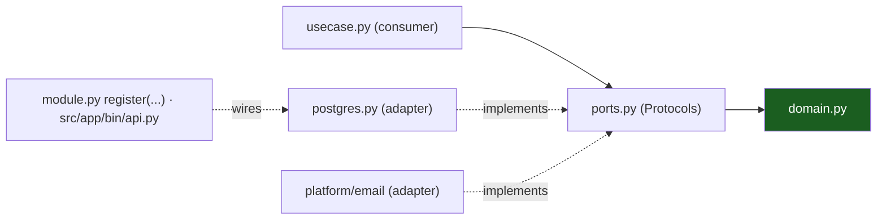

# Hexagonal Architecture

Ports & adapters in Python. The domain sits at the center, declares nothing,
and knows nothing; everything that touches the world enters through a port the
_consumer_ declared.

## 1. The three parts

- **Domain** (`domain.py`): types, invariants, errors. Pure Python — the
  stdlib + `app.shared.*` only. Imports nothing else.
- **Ports**: one or two `typing.Protocol`s per feature, **defined by the
  consumer** (the use case) in `ports.py`. Not "the repository interface next
  to the adapter" — the interface exists because the use case needs it.
- **Adapters**: classes that _implement_ a port, living in the same slice for
  slice-local ones (`postgres.py`, `app/platform/email` for mail) but wired
  nowhere but the composition root.



## 2. Consumer-defined ports

The counter-intuitive part, and the important one: the **use case writes the
protocol**, in its own directory, shaped exactly to its needs — narrow, often
a handful of methods. The adapter satisfies it structurally; mypy checks the
match at the injection point.

```python
# src/app/features/widgets/ports.py — written for the use case, not the database
class WidgetStore(Protocol):
    """Persistence, always filtered by owner."""

    async def insert(self, widget: Widget) -> None: ...
    async def list(self, owner_id: str, limit: int, offset: int) -> list[Widget]: ...
    async def get(self, widget_id: str, owner_id: str) -> Widget | None: ...


class Publisher(Protocol):
    """The realtime surface the use case needs."""

    async def publish(self, room: str, event: dict[str, Any]) -> None: ...
```

`usecase.py` depends only on these types. `postgres.py` (a SQLAlchemy-backed
adapter) and the realtime hub satisfy them; `module.py` wires
`WidgetService(store, publisher, …)`. Swapping Postgres for anything else
touches one file.

## 3. Driving vs driven

- **Driving** (left): HTTP handlers, the WS handler — the _world calls us_. In
  this layout they are the `http.py` adapter: decode the request (pydantic v2),
  call the use case, encode the `{detail, code}` envelope.
- **Driven** (right): Postgres, mail queue, hub, clock — _we call the world_.
  These are the `postgres.py` adapters and platform packages.

Both directions cross a port; only the driven side is faked in unit tests.

## 4. The composition root

One module knows concretions: `src/app/bin/api.py` (worker:
`src/app/bin/worker.py`).

```python
# module.py — per-slice entry the root calls
def register(app: FastAPI, service: WidgetService) -> None:
    """Mount the slice's routes; the caller wires the service."""
    app.include_router(build_router(service), prefix="/api/v1")
```

`register(app, service)` is the whole wiring contract (the `realtime` slice
takes `register(app, hub, tokens)`): the root builds `Deps` (concrete adapters
over the engine + each slice's `queries.py`, and the platform hub), and the
slice exposes nothing else.
`tests/acceptance` builds the same app from a `Deps` of fakes — the
acceptance test _is_ the proof that the root is the only place that knows
types.

```python
# src/app/bin/api.py — the root
@dataclass
class Deps:
    """Everything the app needs, so tests can swap in fakes."""

    settings: Settings
    signup: SignupService
    session: SessionService
    # …
    tokens: Tokens
    hub: Hub = field(default_factory=Hub)
    database: Database | None = None
```

## 5. What the seam buys

- **Unit tests without I/O**: fakes implement `ports.py` in ~10 lines each.
- **Adapter swaps**: SMTP → console sender under `<APP>_OFFLINE=true` is a
  selection function, not a refactor.
- **The linter as lawyer**: import-linter forbids `fastapi`/`sqlalchemy`/
  `asyncpg` inside `domain.py`; violations are red before review.
- **Onboarding**: read one slice top-down and you have read the entire
  architecture once.

## Do / Don't

- **Do** put the protocol where the need lives (`ports.py`); keep it a few
  methods.
- **Do** make adapters dumb: query, map, return domain types — no rules there.
- **Don't** declare a repository protocol "for the future" — no consumer, no
  port (this is Python YAGNI, [Design Patterns](05-design-patterns.md)).
- **Don't** let `domain.py` import `fastapi`, `sqlalchemy`, or another
  slice's files. import-linter will catch you; fix the shape, not the lint.

## Worked example: signup

1. `domain.py` — `SignupUser` pending state, `AUTH_EMAIL_TAKEN`, code TTL.
2. `ports.py` — `SignupStore` protocol (find, register, replace code, consume).
3. `usecase.py` — `signup(...)` → insert pending user, issue a 6-digit code,
   ask the store to enqueue the verification mail; idempotent via the
   re-signup rule.
4. `http.py` — `POST /api/v1/auth/signup`, validates at the edge, 201/409.
5. `postgres.py` / `queries.py` — parameterized `sqlalchemy.text()` SQL.
6. `module.py` — `register(app, service)`.
7. `src/app/bin/api.py` — wires the pg adapter + the outbox.

Eight files, one feature, zero cross-slice imports.

## See also

- [Vertical Slicing](02-vertical-slicing.md)
- [Design Patterns](05-design-patterns.md)
- [Request Lifecycle](07-request-lifecycle.md)
