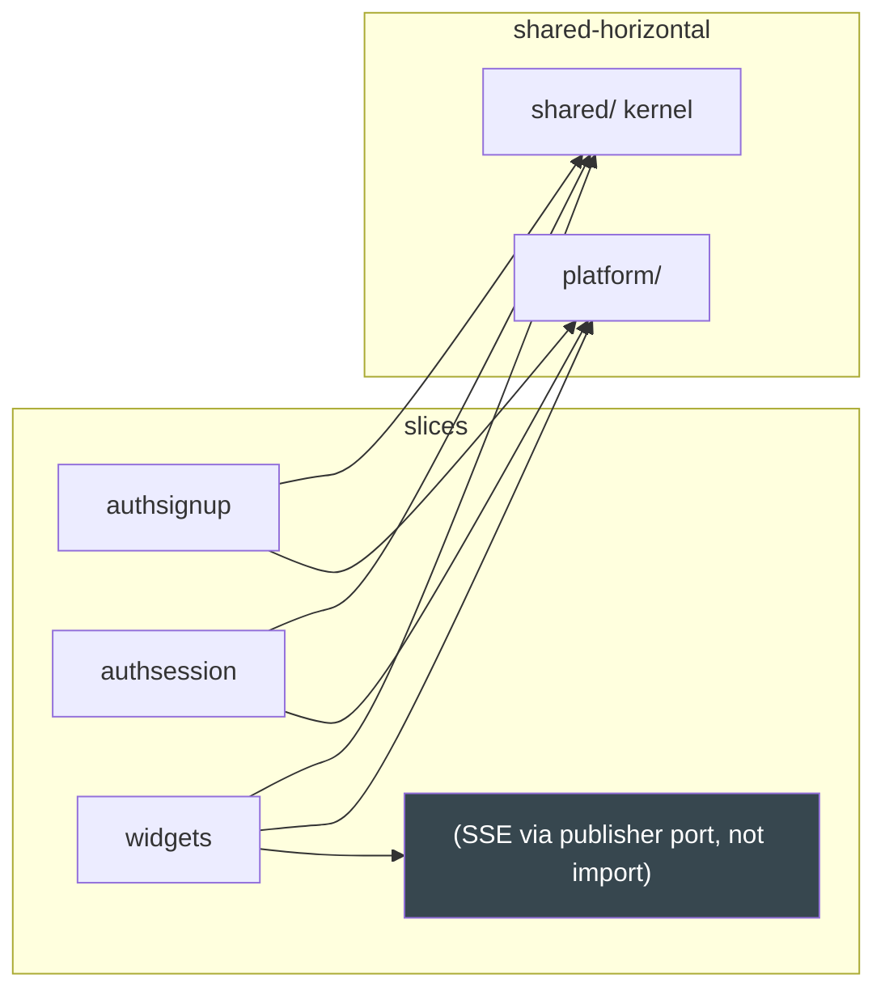

# Vertical Slicing

Layering is horizontal (domain → ports → use case → adapters). **Vertical
slicing** cuts the other way: every feature owns its full stack in one
directory. This template ships seven slices; you replace the example and add
your own.

## 1. The unit: `src/app/features/<slice>/`

A slice is a _capability_, not a table. It contains everything that churns
together, top-down:

```
src/app/features/widgets/
├── domain.py       pure types + rules + errors (app.shared.* only)
├── ports.py        the Protocols this feature needs (consumer-defined)
├── usecase.py      orchestration: rules first, I/O last
├── http.py         FastAPI adapter: edge validation, envelope, routes
├── postgres.py     SQLAlchemy adapter over this slice's queries
├── queries.py      parameterized text() SQL for this slice's tables
└── module.py       register(app, service) — the wiring contract
```

Slices are "tall but narrow": from the HTTP route down to the domain rows,
with zero sideways imports. Tests live beside the code they cover
(`tests/unit/`), and the behavioral contract lives in
`specs/features/*.feature`.

The `realtime` slice is the one exception: it owns only `module.py` (the
WebSocket endpoint), because the hub itself is platform infrastructure.

## 2. The shipped seven

| Slice          | Owns                                                      | Tables                            |
| -------------- | --------------------------------------------------------- | --------------------------------- |
| `authsignup`   | signup (idempotent), verify email, resend code            | `users`, `email_verifications`    |
| `authsession`  | login, refresh (rotation), logout, me, session management  | `sessions`                        |
| `authpassword` | forgot/validate/reset code + rate limit, change password  | `password_resets`                 |
| `adminusers`   | admin list/get/update users, audit logging                | `users` (admin ops), `audit_logs` |
| `authoauth`    | Google One Tap sign-in + GitHub OAuth/link flows          | provider-id columns on `users`    |
| `widgets`      | worked example: CRUD + SSE lifecycle events               | `widgets`                         |
| `realtime`     | WebSocket endpoint `/api/v1/ws?token=`                    | — (hub lives in platform)         |

Boundaries: `authsignup` and `authpassword` never call `authsession`; login
and reset can both need to revoke sessions — the _capability_ is duplicated
through a port, or the shared method is promoted into `shared/`/`platform/`
(kernel-only). If two slices keep reaching for the same port, that is the
signature of a missing shared port, not an import to add.

### How coarse is coarse enough?

One slice ≈ one bounded feature (a group of use cases over one aggregation).
The signup trio (signup/verify/resend) churns together — one slice. Splitting
`verify` into its own directory would triple the boilerplate for nothing;
merging all three auth slices would bury `signup` under `password` code. When
a slice's `domain.py` passes ~200 lines, that is usually two features sharing
a directory — split by behavior, not by file count.

## 3. Slices never import each other



The widgets slice publishes `created/updated/deleted` into the hub **through
a publisher port** — it does not import the `realtime` slice's route. The
realtime slice and the platform hub are the same mechanism at different
altitudes: the _port_ (narrow publisher) lives with the consumer, the _hub
implementation_ lives in `app/platform/realtime`.

The independence is enforced mechanically: the import-linter contract
"Feature slices are independent" in `pyproject.toml` names all seven slice
packages, so a cross-slice import is a red `make lint`.

## 4. Adding a slice

The recipe is [Playbook §1](12-playbooks.md); the checklist: mkdir, the seven
files, queries + `make migrate-add NAME=<table>` (the revision ships its
`downgrade`) + `make generate` if the OpenAPI contract grew, a pytest-bdd
scenario if the behavior is contractual, wire in `src/app/bin/api.py`,
`make ci`. Nothing else in the codebase changes — no registry edits, no god
files. If adding your slice edits three files outside `src/app/features/` and
`src/app/bin/`, the template regressed.

## 5. Anti-patterns

- **Layer-packages across the whole app** (`src/app/repos/`,
  `src/app/services/`, `src/app/handlers/`): the slice is replaced by a
  _horizontal_ directory set, so a feature touches five trees. The seven files
  per slice exist precisely to kill those god-directories.
- **Cross-slice imports "temporarily"**: import-linter denies them. The fix
  is a port or a kernel promotion, never a suppression comment.
- **A slice that owns another slice's table**: ownership follows capability.
  `adminusers` may update `users`, but it does not own the signup flow — it
  consumes an admin-shaped port, and its queries are its own, in its own
  `queries.py`.
- **Shared mutable singletons in slices**: per-slice state is a dependency of
  `register(...)`; anything global should live in `platform/` and be injected.

## See also

- [Hexagonal Architecture](01-hexagonal-architecture.md)
- [Package Topology](03-package-topology.md)
- [Dependency Rules](04-dependency-rules.md)
