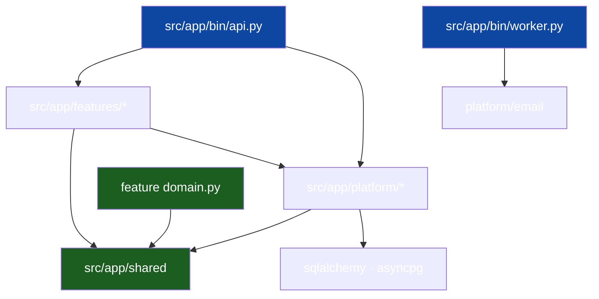

# Package Topology

The dependency graph of the single Python project: which modules exist, what
each is allowed to know, and who sits where. This is the Python template's
answer to the sibling languages' module/crate workspaces: one project, many
directories, the edges enforced by the import-linter contracts declared in
`pyproject.toml` over the import package `app`.

## 1. Module taxonomy

| Module                                | Kind                  | May import                              | Never imports                 |
| ------------------------------------- | --------------------- | --------------------------------------- | ----------------------------- |
| `src/app/features/<slice>/domain.py`  | domain                | stdlib, `app.shared.*`                  | anything else                 |
| `…/<slice>/ports.py`                  | ports                 | domain                                  | adapters, other slices        |
| `…/<slice>/usecase.py`                | use case              | domain, ports                           | `sqlalchemy`, `fastapi`, other slices |
| `…/<slice>/http.py`                   | driving adapter       | use case, `app.platform.*`              | other slices                  |
| `…/<slice>/postgres.py`               | driven adapter        | `sqlalchemy`, own `queries.py`          | `fastapi`, other slices       |
| `…/<slice>/module.py`                 | wiring                | all files in its slice                  | other slices                  |
| `src/app/shared/*`                    | kernel                | stdlib only                             | anything                      |
| `src/app/platform/*`                  | transversal infra     | stdlib, `sqlalchemy`, `app.shared.*`    | `app.features.*`              |
| `specs/openapi.yaml`                  | generated (committed) | —                                       | —                             |
| `src/app/bin/api.py`, `…/bin/worker.py` | composition roots   | everything                              | — (nobody imports them)       |

## 2. The import graph

Arrows converge on `shared/` and each slice's `domain.py`. Nothing points at
`bin/`; nothing points sideways between features.

## 3. `shared/` vs `platform/`

Both are horizontal, and the line matters:

- **`shared/` is the kernel** — types and rules so fundamental they may never
  depend on a mechanism: `apperr` (the stable `Code` enum and the `AppError`
  dataclass every error crosses the boundary as), `authz` (the
  self-or-subordinate manage guard), `rolex` (the single role definition with
  `at_least`), `clockx` (the injectable `Clock`), `idgen` (uuids, opaque
  tokens, numeric codes). If a file in `shared/` grows an import beyond the
  stdlib, move it to `platform/` — import-linter enforces this: the
  "Domain and kernel are I/O-free" contract names `app.shared` as a source
  module.
- **`platform/` is transversal infra** — `authx` (PyJWT HS256
  minter/verifier, `require_auth`/`require_role` dependencies, argon2id
  password hashing), `oauthx` (Google JWKS verifier, GitHub client, link
  tokens), `email` (`EmailMessage`, the outbox, console/SMTP sender
  selection, the drain and janitor loops, the templates), `realtime` (hub +
  WS session pump + SSE framing), `envelope` (the error body, the request
  helpers, pagination), `config` (pydantic-settings env load), `db` (the
  engine and session factory), `logging` (the stdlib JSON formatter). It may
  touch `sqlalchemy`; it may **not** import features. Features may import
  platform modules — but prefer declaring the narrow port in `ports.py` and
  letting platform satisfy it, so the slice stays readable as a stand-alone
  contract.

## 4. `specs/openapi.yaml` — generated, committed

The contract is **exported from the running app** by
`scripts/export_openapi.py`, not generated into a source tree: the app's
routes are the source of truth, and the YAML is the artifact CI keeps
honest. `make generate` rewrites it; `make gen-check` fails when the
committed file is stale. Never hand-edit it.

This template ships **no** generated client and **no** `src/gen/` — the
pydantic request/response models in each slice's `http.py` are hand-written,
and the contract is the drift detector. (The Go sibling generated named
queries with sqlc; this template's typed queries are hand-written per slice
in `queries.py` — the documented codegen delta.)

## 5. Role → file map

| Task                   | Lives in                                            |
| ---------------------- | --------------------------------------------------- |
| Business rule change   | `domain.py` (its unit tests)                        |
| New query              | the slice's `queries.py` + `postgres.py`            |
| New endpoint           | `http.py`, route in `module.py`; OpenAPI entry      |
| New vendor integration | new `app/platform/<x>/` port + adapter              |
| Cross-cutting concern  | `src/app/bin/middleware.py` + `platform/envelope.py` |
| Wiring change          | `src/app/bin/api.py` only                           |
| Kernel types           | `src/app/shared`                                    |

## 6. Why one project, not many

One project keeps `uv sync`, the tool-deps (alembic, ruff, mypy,
import-linter) and CI cheap; the import package `app` namespaces the layers
without a build step, and `mypy_path = "src"` plus the src layout make the
package installed rather than merely on the path. Two projects or a workspace
would buy nothing but version skew between `shared/` copies. Python tolerates
import cycles at runtime, so the file-level law (`domain.py` purity, slice
isolation) is enforced by import-linter, not by the import system.

## See also

- [Vertical Slicing](02-vertical-slicing.md)
- [Dependency Rules](04-dependency-rules.md)
- [Project Skeleton](13-project-skeleton.md)
