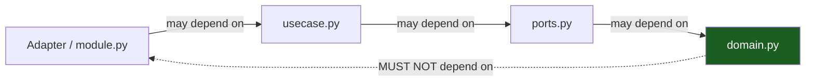

# Dependency Rules & Boundaries

The dependency rule in depth: allowed vs forbidden edges, and how the
import-linter contracts in `pyproject.toml` turn the architecture into
red-on-save lint output.

## 1. The rule

**Source-code dependencies only point toward more-stable code.** An outer
module may name an inner one; an inner one must never name an outer. Python
tolerates import cycles at runtime, which makes the linter — not the import
system — the enforcement point for the interesting edges (they are _file-level
within one tree_, invisible to any package tooling).



## 2. Allowed edges

| From                                             | To                                              | OK?                              |
| ------------------------------------------------ | ----------------------------------------------- | -------------------------------- |
| `src/app/bin/api.py`, `src/app/bin/worker.py`    | any internal module                             | yes — the roots know everything  |
| feature `http.py` / `postgres.py` / `module.py`  | own slice's files, `app.platform.*`, `app.shared.*` | yes                          |
| `usecase.py`                                     | `ports.py`, `domain.py`, `app.platform.*`, `app.shared.*` | yes                         |
| `ports.py`                                       | `domain.py`                                     | yes                              |
| `domain.py`                                      | stdlib, `app.shared.*`                          | yes                              |
| feature `postgres.py`                            | `sqlalchemy`, own `queries.py`                  | yes                              |
| `src/app/platform/*`                             | `app.shared.*`, stdlib, `sqlalchemy`            | yes (never features)             |

## 3. Forbidden edges

| From                                 | To                                     | Why                                           |
| ------------------------------------ | -------------------------------------- | --------------------------------------------- |
| `domain.py`                          | `fastapi`, `sqlalchemy`, any adapter   | domain is zero-I/O and transport-agnostic     |
| `usecase.py`                         | `fastapi`, `sqlalchemy`, `asyncpg`     | mechanism names belong to adapters            |
| any `src/app/features/*` file        | another slice's files                  | slices stay independent                       |
| `src/app/platform/**`                | `app.features.*`                       | platform serves features, never consumes them |
| any module outside a feature's files | its `module.py` `register` internals   | wiring is the root's job                      |
| any module                           | `src/app/bin/**` (importing the root)  | nothing depends on the root                   |

## 4. Enforcement: the import-linter contracts in `pyproject.toml`

The skeleton ships the authoritative file — the essence, condensed. Three
contracts, the verbatim translation of the Go sibling's depguard pairs:

```toml
[[tool.importlinter.contracts]]
name = "Layered architecture (dependencies point inward)"
type = "layers"
layers = ["app.bin", "app.features", "app.platform", "app.shared"]

[[tool.importlinter.contracts]]
name = "Domain and kernel are I/O-free"
type = "forbidden"
source_modules = [
  "app.shared",
  "app.features.authsignup.domain",
  "app.features.authsession.domain",
  "app.features.authpassword.domain",
  "app.features.authoauth.domain",
  "app.features.adminusers.domain",
  "app.features.widgets.domain",
]
forbidden_modules = ["fastapi", "sqlalchemy", "asyncpg", "alembic", "httpx", "uvicorn"]

[[tool.importlinter.contracts]]
name = "Feature slices are independent"
type = "independence"
modules = [
  "app.features.authsignup",
  "app.features.authsession",
  "app.features.authpassword",
  "app.features.authoauth",
  "app.features.adminusers",
  "app.features.widgets",
  "app.features.realtime",
]
```

The contract names are placeholder-free (`app.features.*` survives rename
unchanged); everything else in the file renames with the project via
`scripts/rename.sh` like any other text.

Stacked enforcement, in order:

1. **import-linter** — file-level law; `make lint` fails red with the
   violating edge. It analyzes the whole import graph (`root_packages = ["app"]`,
   `include_external_packages = true`), so it also catches a slice reaching
   for `fastapi`.
2. **mypy** — `make vet` (`mypy src`, `strict = true`) rejects imports that
   resolve to nothing and mismatched protocol implementations; a
   wrong-shaped edge that still type-checks is import-linter's catch.
3. **ruff** — `make lint` also runs `ruff check .`, whose `I` (isort) rule
   orders imports and whose `S`/`ASYNC`/`DTZ` rules catch the mechanism leaks
   that do not show up as imports.
4. **Generated-contract hygiene** — `make generate`/`make gen-check` must stay
   quiet; CI regenerates and diffs.
5. **Review** — the "depends on the interface but reaches for the adapter"
   smell; import-linter cannot see it because it is a constructor argument,
   not an import.

## 5. Invariants the structure protects

- **One error vocabulary.** Adapters map driver errors _inward_ (SQLAlchemy's
  `IntegrityError` → `AUTH_EMAIL_TAKEN`); use cases raise domain
  `AppError`s; the stable `code` for the `{detail, code}` envelope is decided
  once, in `src/app/shared/apperr.py`. Callers never see raw SQLAlchemy error
  shapes.
- **SQL lives only in per-slice `queries.py` files.** A raw
  `session.execute(text(...))` in `postgres.py` bypassing `queries.py`, or
  worse in `usecase.py`, is a leak — the "Domain and kernel are I/O-free"
  contract keeps `sqlalchemy` out of `domain.py` and `shared/`; review
  denies the bypass inside the adapters.
- **Wire types stop at the edge.** pydantic models in `http.py` decode and
  encode; domain dataclasses travel inward and back.
- **Slices keep separate migration ownership.** A slice's tables appear
  through its own `queries.py`; another slice reading them directly is an
  edge violation the slice-independence contract catches when it turns into
  an import, and review catches when it does not.
- **Migrations never run at startup.** Nothing in `platform/` knows how to
  apply them; `make migrate-up` (or the compose `migrations` one-shot
  service) does, in a boot step you control.

## Do / Don't

- **Do** add a narrow port when a slice needs what another slice owns — even
  if its adapter today is a thin proxy to the other slice's adapter.
- **Do** promote a genuinely shared type to `shared/` once two slices need it.
- **Don't** weaken an import-linter contract or add a `# noqa` to sneak an
  edge; if the edge is needed, the topology is wrong (or the rule is — fix
  the rule in review, never the call site).
- **Don't** create `src/app/utils`. `shared/` is a kernel, not a junk drawer;
  anything "util" is either a mechanism (→ `platform/`) or a domain concept
  (→ the slice that owns it).

## See also

- [Package Topology](03-package-topology.md)
- [Testing & CI](11-testing-and-ci.md)
- [Hexagonal Architecture](01-hexagonal-architecture.md)
