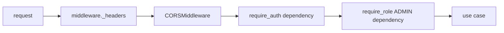
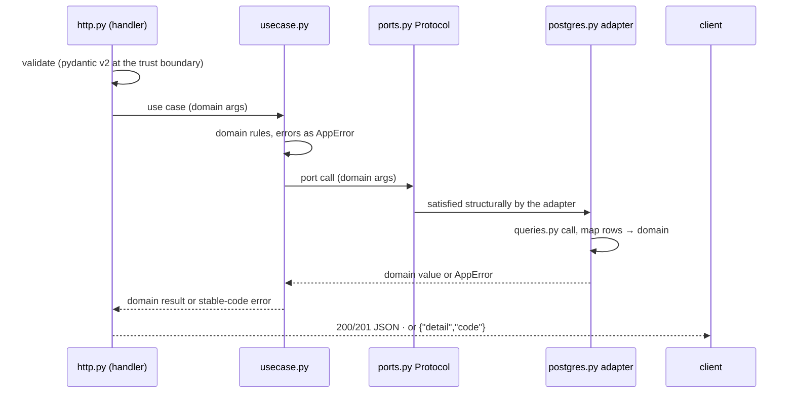

# Request Lifecycle

One request's full path through the hexagon: from FastAPI's router through
the middleware chain into the injected identity, the use case, the port, and
the adapter — plus the asides for connections that never end (WS) or stream
(SSE).

## 1. The router

FastAPI's `APIRouter` matches method + `{path_param}` routes natively — no
extra router:

```python
@router.get("/widgets/{widget_id}")
async def get_widget(widget_id: str, identity: IdentityDep) -> WidgetResponse:
    return _model(await service.get(widget_id, identity.user_id))
```

Routes are declared in each slice's `http.py: build_router(service)` and
mounted by `module.py: register(app, service)` — one mount point per slice
keeps the route inventory in one readable place:

```python
def register(app: FastAPI, service: WidgetService) -> None:
    """Mount the slice's routes; the caller wires the service."""
    app.include_router(build_router(service), prefix="/api/v1")
```

The composed app exposes **30 paths** in `specs/openapi.yaml`. The slice
routes live under `/api/v1`; `/healthz` and `/readyz` are registered
directly on the app (unprefixed) in `src/app/bin/api.py`, and the WebSocket
endpoint is `/api/v1/ws` (WebSockets do not appear in the OpenAPI
document).

## 2. The middleware chain

Cross-cutting layers are Starlette middleware installed once by
`install_middleware(app, settings)` (`src/app/bin/middleware.py`); route
guards are FastAPI dependencies ([Design Patterns §3](05-design-patterns.md)):



- `CORSMiddleware` is installed **only** when `<APP>_CORS_ORIGINS` is
  non-empty; the allowlist is exact (no wildcard default), the methods are
  the six verbs, and `x-request-id` is both an allowed and an exposed header.
- `_headers` is an `@app.middleware("http")` function: it echoes an incoming
  `x-request-id` or mints one (`uuid4().hex`), then sets
  `x-content-type-options: nosniff`, `x-frame-options: DENY` and
  `referrer-policy: no-referrer` on the way out.
- **Stack order:** Starlette runs the *last added* middleware outermost, and
  the header function is registered after `CORSMiddleware`, so the header
  pass wraps the CORS layer. The `x-request-id` therefore reaches the client
  even on a CORS preflight.
- `require_auth` (`app/platform/authx.py`) resolves `Authorization: Bearer`
  through `HTTPBearer(auto_error=False)`, parses it with the HS256 verifier
  and returns the `Identity`. A missing header is `UNAUTHENTICATED` (401); a
  token the verifier rejects is `AUTH_INVALID_TOKEN` (401).
- `require_role(floor)` is a dependency factory: it depends on
  `require_auth` and checks `at_least(identity.role, floor)`; failure is 403
  `FORBIDDEN`. Slices declare it as an alias —
  `Admin = Annotated[Identity, Depends(require_role(Role.ADMIN))]`.

## 3. Identity as an injected value

The identity is a frozen dataclass returned by the dependency, so it cannot
collide with anything and its shape is greppable:

```python
@dataclass(frozen=True)
class Identity:
    user_id: str
    email: str
    role: Role
```

Use cases never re-parse tokens and never see a `Request` — the handler
passes the parsed input and the identity fields it declared in its own
signature. That boundary is what lets the same use case serve HTTP, a WS
handshake, or a CLI.

Two platform handles travel through `app.state` instead of the dependency
graph: `app.state.tokens` (the `Tokens` minter/verifier) and `app.state.hub`
(the realtime `Hub`). Handlers that need them read `request.app.state`.

## 4. The inward slide



Edge rules: `http.py` validates at the trust boundary — a pydantic v2 model
with `StringConstraints` (length, pattern, normalization) — because the
domain must not trust wire data; `domain.py` re-checks invariants because
adapters and tests may call it directly. A `RequestValidationError` never
reaches the handler: `install_error_handlers` converts it into a 422
`VALIDATION_FAILED` envelope. Error flow is strictly an `AppError` (with
`raise ... from exc` wrapping where context is added) ending in `Code`
values; the handlers in `app/platform/envelope.py` are the only place that
renders an HTTP status from a code. The catch-all `Exception` handler is
the last resort: it logs the trace once and answers 500
`{"detail": "internal server error", "code": "INTERNAL"}` — no internals
reach the client, and every failure on the API answers the same envelope
shape.

## 5. Aside: WebSocket and SSE requests

Two endpoints do not terminate — the lifecycle diverges after the token is
resolved:

- **WS** `/api/v1/ws?token=<jwt>` — the realtime slice
  (`app/features/realtime/module.py` → `app/platform/realtime/ws.py`) takes
  the token from the query, because browsers cannot set `Authorization` on a
  WebSocket handshake. A missing or invalid token still **completes the
  handshake** and only then closes the socket with code **4001, reason
  `authentication_failed`** — the client observes the close code instead of
  an opaque handshake rejection. On success the connection greets with
  `{"type": "hello", "user_id": ...}`, subscribes to the identity room
  `user:{id}` on the hub, answers a client `ping` with `pong`, sends its
  own `ping` every 30 s, and pumps each hub event as one JSON frame until
  the socket closes ([Realtime](09-realtime-and-streaming.md)).
- **SSE** `GET /api/v1/widgets/events` — behind the normal auth chain; the
  handler answers a `StreamingResponse` with `text/event-stream`,
  `cache-control: no-cache` and `x-accel-buffering: no`, subscribes to the
  widgets room, and yields one `data:` frame per event, with a `: keep-alive`
  comment every 15 s.

Both stream paths unbind their hub subscription on disconnect — the
disconnect *is* the cancellation — and never hold database rows while
streaming.

## 6. The worker's lifecycle (for contrast)

No request at all: `src/app/bin/worker.py` builds the same config + engine
and runs two loops, both exiting on SIGINT/SIGTERM through one
`asyncio.Event` (`loop.add_signal_handler(signum, stop.set)`). The email
outbox loop is `outbox_loop(database, sender, settings, clock, stop)`; the
janitor loop ticks every `<APP>_JANITOR_POLL_SECONDS` (default 1 h) and
issues idempotent DELETEs — expired-but-still-active `sessions`, and expired
`email_verifications` / `password_resets` — logging only when it actually
removed rows. Both loops never touch rotation history or audit rows, so
running one worker per deployment is safe and running two is harmless
(idempotent, replica-safe). One mental model, two entrypoints — a
single-image deploy still needs _a_ worker process, or mail and purges stop.

## 7. Aside: redirect endpoints (302, never JSON)

Two lifecycle shapes sit outside the JSON envelope rule:

- **GitHub OAuth** — `/api/v1/auth/github/login` and
  `/api/v1/auth/github/callback` answer **302** redirects (authorize URL,
  then the frontend success URL with the token pair in the fragment, or the
  error in the query string). A provider that is not configured answers the
  JSON envelope with 503 `AUTH_OAUTH_FAILED`; a failed exchange redirects with
  `?error=<CODE>&error_description=...`.
- **WS/SSE** — §5 above; the same "the handler decides the wire shape"
  principle, just held open instead of redirected.

## See also

- [Auth Architecture](06-auth-architecture.md) — what `Identity` carries
- [Realtime & Streaming](09-realtime-and-streaming.md)
- [Errors, Config & Observability](10-error-config-observability.md) — the
  envelope mapping
