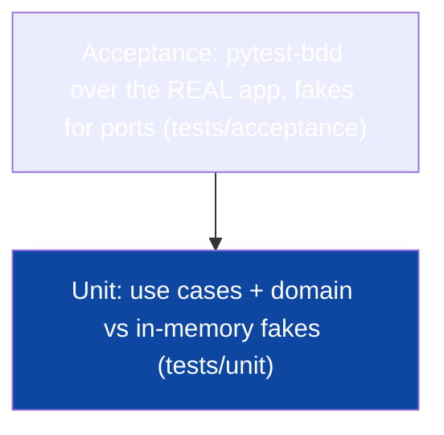

# Testing & CI

The test pyramid as this stack expresses it — unit fakes and pytest-bdd
acceptance on a fake-wired real app — and the one gate: `make ci`.

## 1. The pyramid



| Level          | Runner                    | Database     | Speed | Catches                          |
| -------------- | ------------------------- | ------------ | ----- | -------------------------------- |
| **Unit**       | `make test` (pytest)      | fakes        | ms    | business rules, envelope mapping |
| **Acceptance** | `make accept` (pytest-bdd)| none — fakes | fast  | behavioral contracts end to end  |

The template ships no integration lane. Adapter SQL and migration
correctness are the two things the shipped tiers cannot prove; when the
project grows a schema worth protecting, add the lane deliberately (§3).

Shipped counts: 14 unit tests, 73 acceptance tests (14 HTTP contract checks
+ 59 BDD scenario cases — 56 scenario definitions, two of them outlines that
expand), 14 kit contract evals.

## 2. Unit: fakes, not mocks

Ports are consumer-defined `Protocol`s
([Design Patterns §2](05-design-patterns.md)), so a fake is a plain class —
no mocking framework, no spy magic:

```python
class FakeWidgetStore:
    def __init__(self, world: World) -> None:
        self.w = world
```

The shared doubles live in `tests/fakes.py` (`World` — one in-memory state
object read by every fake — plus `SequenceIds` for deterministic ids and
codes, and `FakePublisher` for the realtime port). The clock is a port
(`Clock` in `app/shared/clockx.py`); tests inject `FixedClock` and advance
it explicitly, so nothing sleeps and nothing reads the wall clock.
`asyncio_mode = "auto"` means the async test functions need no decorator.

Rules worth enforcing: no `time.sleep`, no network, no real Postgres —
table-driven cases cover branches, and `pytest.raises(AppError)` asserts on
the stable `code`, never on the message.

## 3. Integration: a lane you add, not one that ships

The Makefile has no `test-int` target and the template has no
`testcontainers` dependency. That is deliberate: the shipped suites need no
Docker, so `make ci` stays an offline gate, and an empty integration lane
would be a lie with a green checkmark.

What belongs in that lane when you add it: the Postgres adapters' mapping
truth, the `FOR UPDATE SKIP LOCKED` claim semantics of `email_jobs`, and
the upgrade/downgrade pairs in `migrations/`. Add it as a separate pytest
marker (or a `tests/integration/` directory excluded from `make test`), boot
one Postgres 17 container, apply migrations, and keep the target out of
`make ci` so the default loop stays fast and offline.

## 4. Acceptance: pytest-bdd on the fake-wired app

`specs/features/*.feature` holds behavioral contracts; `tests/acceptance/`
builds the **real** FastAPI app via `build_app(deps)` with in-memory fakes
(a fake clock, a recorded mail queue, a fake Google ID-token verifier and a
fake GitHub client so both social flows run offline with deterministic
codes); the realtime `Hub` is the real one, so the SSE scenario exercises
the actual fan-out:

```gherkin
Feature: Session management
  Background:
    Given a verified user "ada@ex.com" with password "s3cure-pass-123"

  Scenario: Refresh rotates the session and retires the old token
    When I log in as "ada@ex.com" with password "s3cure-pass-123" and remember the pair as ada
    And I refresh using the token "ada"
    Then the response status is 200
    When I refresh using the token "ada"
    Then the response status is 401
    And the response code is "AUTH_INVALID_TOKEN"
```

The steps live in `tests/acceptance/steps_*.py` — one module per slice
(`steps_signup.py`, `steps_session.py`, `steps_password.py`,
`steps_oauth.py`, `steps_admin.py`, `steps_widget.py`) plus the generic
request/assertion steps in `steps_http.py`; shared helpers and the
per-scenario state object `Ctx` are in `tests/acceptance/support.py`.
`tests/acceptance/conftest.py` re-exports the step functions as fixtures
(pytest-bdd registers each step in the module that defines it, and pytest
only resolves fixtures from the test module and the conftest chain).

`tests/acceptance/test_bdd.py` binds the feature files with
`pytest_bdd.scenarios(...)`: `authsignup.feature`, `authsession.feature`,
`session-mgmt.feature`, `authpassword.feature`, `authoauth.feature`,
`adminusers.feature` and `widgets.feature` — every auth slice plus the
example one.

Because pytest-bdd does not await async step functions, the server runs in
a **background thread** on an ephemeral port (`uvicorn.Config(app, port=0)`)
and the steps talk to it with a plain `httpx.Client` — the steps stay
synchronous and the app under test is the real ASGI app.

This is the proof of the composition root: `tests/conftest.py` is the second
wiring of the same `build_app` — if a slice's dependencies needed anything a
fake cannot provide, acceptance would fail and the architecture violated.

## 5. The kit contract evals

`evals/contracts_test.py` validates the `.claude` layer with plain pytest —
a hand-rolled frontmatter parser plus a body-section checker for agents,
skills and commands. It asserts the required fields and sections, the
allowed divisions, LF line endings, and that no literal template
placeholder leaked into the tree (`<app>`, `<APP>`, `<scope>` — the tokens
are assembled at runtime so this file never spells one out).

```sh
make evals   # pytest evals — 14 tests, local only
```

## 6. The gate: `make ci`

```sh
make ci   # fmt-check + vet (mypy) + lint (ruff + import-linter) + gen-check + test + accept + evals
```

- **fmt-check** — `ruff format --check .` is the gofmt analog: formatting is
  not negotiable, so diffs stay content-only.
- **vet** — `mypy src` in strict mode is the `tsc --noEmit` analog.
- **lint** — `ruff check .` plus `lint-imports`, which enforces the
  architecture contracts declared in `pyproject.toml` (layered
  dependencies, I/O-free domains, slice independence).
- **gen-check** — `make generate` must leave the committed
  `specs/openapi.yaml` byte-identical; a stale contract fails the gate.
- **pytest** — the unit and acceptance tiers, offline, no Docker.
- **evals** — the kit contract suite.

Dependencies are pinned to version ranges and **no lockfile is committed**
(INV-T3): `uv.lock` is git-ignored, so a fresh install resolves the newest
in-range versions. Commit a lockfile after instantiation if you need
byte-reproducible installs.

CI (`.github/workflows/ci.yml`) runs `make ci`, then `make vuln`
(`pip-audit`), then actionlint. `make ci` remains the local gate. Coverage
targets behavior, not lines — the pyramid's shape is the coverage policy.

## 7. CI hygiene

- The generated contract is committed (`specs/openapi.yaml`), and CI checks
  regeneration is a no-op — no generation step can hide edits.
- Caching: `actions/setup-python` with `python-version: 3.12`; with no
  committed lockfile the `uv sync` step resolves fresh every run.
- The vulnerability scan (`make vuln`) runs as its own job — see
  [Errors, Config & Observability §5](10-error-config-observability.md).
- Concurrency surface: the hub is the one; its drop-oldest and
  idempotent-unsubscribe semantics are the behaviors to pin when you extend
  it. `asyncio` removes the data-race class the sibling's race detector
  addresses — what remains to test is _subscription hygiene_.

## Do / Don't

- **Do** test use cases through fakes first; add a BDD scenario when the
  behavior is contract.
- **Do** keep fakes in `tests/fakes.py` — they are not production
  interfaces.
- **Don't** run Postgres in unit tests, or fake Postgres in integration
  tests — each level earns its keep at its altitude.
- **Don't** merge with a red `make ci`; the import-linter contracts encode
  the architecture, and a suppressed violation is an architecture decision
  taken in private.

## See also

- [Playbooks](12-playbooks.md) — test placement per change type
- [Dependency Rules](04-dependency-rules.md)
- [Realtime & Streaming](09-realtime-and-streaming.md) — the concurrency surface
