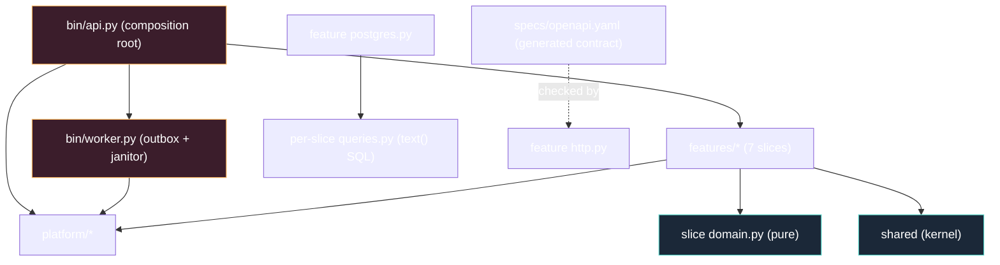

# Project Skeleton

The annotated guide to the template tree next to this `docs/` tree.
Everything is generic until `scripts/rename.sh` runs — the package name
`app-template` and the env prefix `<APP>_` are placeholders and the project
cannot be configured before that.

## 1. The shape you are building toward



## 2. Directory layout

```text
<app>/
├── pyproject.toml           # name "app-template", requires-python >=3.12, hatchling;
│                            # ruff + mypy + pytest + import-linter config (the dependency law)
├── Makefile                 # ci · test · accept · evals · generate · gen-check · migrate-{up,down,add} · vuln
├── alembic.ini              # script_location=migrations · prepend_sys_path=src · empty sqlalchemy.url
├── .env.example             # placeholder values; <APP>_JWT_SECRET placeholder-guarded
├── .gitignore               # uv.lock ignored (INV-T3) · .venv · __pycache__ · caches
├── .github/workflows/       # ci.yml + deploy · docker-publish · rollback
├── Dockerfile               # single-stage python:3.12-slim, non-root uid 10001, stdlib healthcheck
├── docker-compose.yml       # postgres · one-shot migrations · api · worker (dev)
├── docker-compose.prod.yml  # nginx edge + api + worker + release-step migrations (tools profile)
├── infra/nginx/             # edge config for the production composition
├── migrations/              # env.py + script.py.mako + versions/0001_init.py · 0002_profiles.py
├── specs/                   # openapi.yaml (generated) + features/*.feature
├── evals/                   # contracts_test.py — the .claude kit contract suite (pytest)
├── tests/                   # conftest.py · fakes.py · unit/ · acceptance/
│   └── acceptance/          # steps_*.py per slice · support.py · test_bdd.py · test_http.py
├── scripts/                 # rename · verify-template · export_openapi · lint-* · leak-guard
│                            # + install-claude-runtime · hooks/guard-bash.sh
├── docs/                    # this handbook
├── .claude/                 # agents · skills · commands · schemas · settings · manifest
└── src/
    └── app/                 # the import package is `app` (src layout)
        ├── bin/
        │   ├── api.py       # root: Settings → wire() → build_app() → uvicorn
        │   ├── worker.py    # root: Settings → outbox loop + janitor loop (scale-out entry)
        │   └── middleware.py # request-id · security headers · CORS
        ├── features/        # authsignup · authsession · authpassword · authoauth · adminusers · widgets · realtime
        │   └── <each>       # domain.py ports.py queries.py postgres.py usecase.py http.py module.py
        ├── platform/        # authx · oauthx · email · realtime · config · db · envelope · logging
        └── shared/          # apperr (stable codes) · rolex · authz · clockx · idgen — kernel only
```

Conventions:

1. **The same file set per slice, always.** "Where does X live?" is
   answerable by file kind, never by grep. The realtime slice is the one
   exception: it owns only `module.py` (the WebSocket endpoint) because the
   hub itself is platform infrastructure.
2. **The contract is committed** (`specs/openapi.yaml`) so CI needs no
   generator in the loop; `make generate` / `make gen-check` keep it honest.
3. **The src layout is the law**: the import package is `app`, so every
   import is `from app.features... import ...` — never a relative path that
   walks out of the package.

## 3. `pyproject.toml` — the keystone

The project name `app-template` and the description are placeholders until
rename. `requires-python = ">=3.12"`; the build backend is hatchling with
`packages = ["src/app"]`. Dependencies are the runtime set (alembic,
argon2-cffi, asyncpg, fastapi, httpx, pyjwt, pydantic, pydantic-settings,
sqlalchemy[asyncio], uvicorn[standard]); the dev group holds ruff, mypy,
pytest, pytest-asyncio, pytest-bdd, import-linter, pip-audit and pyyaml.

The same file is the architecture law: `[tool.importlinter]` declares three
contracts — the layered dependency order (`app.bin` → `app.features` →
`app.platform` → `app.shared`), the forbidden-import list for the domain
and kernel modules, and the independence of the seven slices. `make lint`
runs `lint-imports` next to ruff, so a violation is red, not reviewable.

## 4. The Makefile

```
make ci           fmt-check + vet (mypy) + lint (ruff + import-linter) + gen-check
                  + test + accept + evals
make test         unit tier (pytest tests/unit; no DB needed)
make accept       pytest-bdd over tests/acceptance (fake-wired app)
make evals        pytest evals — the .claude kit contract suite
# no integration lane ships — see docs/11-testing-and-ci.md §3
make generate     export_openapi.py → specs/openapi.yaml (gen-check verifies no drift)
make migrate-up / migrate-down / migrate-add NAME=
make run          python -m app.bin.api   (set <APP>_DATABASE_URL first)
make worker       python -m app.bin.worker
make vuln         pip-audit
make verify       staged renamed copy + full factory smoke (scripts/verify-template.sh)
```

## 5. The composition roots

`bin/api.py` (one function, sequential): `Settings()` → `wire(settings)`
builds the engine, the clock, the ids, the hub, the `Passwords`/`Tokens`
and one service per slice → `build_app(deps)` installs the error handlers,
the middleware, registers every slice, and mounts `/healthz` + `/readyz` →
`uvicorn.run(...)`. `build_app` takes its dependencies as an argument and
performs no import-time I/O, which is what lets the acceptance tier wire
fakes into the same function.

`bin/worker.py` opens the same database and runs two loops on one
`asyncio.Event` — `outbox_loop` (outbox polling) and `janitor_loop`
(`<APP>_JANITOR_POLL_SECONDS`, default 1 h: expired sessions + stale
verification and reset codes) — same image, different entrypoint, because
the outbox deserves its own lifecycle at scale. SIGINT/SIGTERM set the stop
event; the tasks are cancelled and awaited, then the engine is disposed.
Both roots validate config at boot; neither applies migrations.

## 6. What ships in the box (and what does not)

Ships: seven slices (authsignup, authsession, authpassword, authoauth,
adminusers, widgets, realtime), the full auth core — argon2id passwords
with an optional pepper, Google One Tap + GitHub social sign-in
(`platform/oauthx`), session management with rotation and the admin
auth-session surface and anomalies, the `authz` self-or-subordinate guard,
outbox email, a worker janitor, WS + SSE, health gates, CI, compose for dev
(postgres + one-shot migrations + api + worker) and for prod (nginx + api +
worker + release-step migrations), the `.claude/` agency layer, this docs
tree.

Does **not** ship: billing/Stripe, a frontend, migrations-at-startup (the
compose one-shot migrations service is the deployed path), multi-replica
realtime (a broker adapter is the documented evolution), otel (cut; seams
documented). Delete the `widgets` example and your rename is done; the rest
is product-ready scaffolding.

## See also

- [Playbooks](12-playbooks.md) — the first changes you will make
- [Package Topology](03-package-topology.md)
- [Testing & CI](11-testing-and-ci.md)
