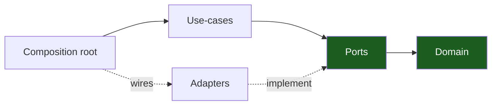

# Backend Python Architecture Handbook

A **generic, reusable** reference for building a Python backend with
**hexagonal architecture (ports & adapters) + vertical slicing**, realized as
a single `src`-layout project (Python 3.12, uv, FastAPI 0.115+, SQLAlchemy 2
async + asyncpg, Alembic). Every chapter teaches the pattern abstractly
first, then shows a worked example (`### Worked example`) so you can lift the
structure into any project. Replace `<app>` with your project name and
`<scope>` with your org/module prefix throughout.

> 15 chapters · adapted to Python idioms (`typing.Protocol` ports, FastAPI
> dependencies, pydantic v2 at the edges, `asyncio` concurrency, import-linter
> architecture contracts).

## The one rule

**Dependencies point inward.** The domain knows nothing about I/O; the
composition root (`src/app/bin/api.py`) knows about everything and wires it
together. Everything else makes that rule cheap to follow and hard to break.
See [Dependency Rules](04-dependency-rules.md).

## Start here

New? Read [00 — Overview & Principles](00-overview-and-principles.md), then
[01 — Hexagonal Architecture](01-hexagonal-architecture.md) and
[03 — Package Topology](03-package-topology.md). Starting a fresh project?
Jump to [13 — Project Skeleton](13-project-skeleton.md) and
[12 — Playbooks](12-playbooks.md).

## Contents

| #   | Chapter                                                            | What it covers                                                                                    |
| --- | ------------------------------------------------------------------ | ------------------------------------------------------------------------------------------------- |
| 00  | [Overview & Principles](00-overview-and-principles.md)             | The one idea + 8 principles + chapter map                                                         |
| 01  | [Hexagonal Architecture](01-hexagonal-architecture.md)             | Ports & adapters, consumer-declared `Protocol`s, dependency inversion                              |
| 02  | [Vertical Slicing](02-vertical-slicing.md)                         | One feature per package over a shared kernel; the seven shipped slices                            |
| 03  | [Package Topology](03-package-topology.md)                         | Module taxonomy, the import graph, role→module map                                                |
| 04  | [Dependency Rules](04-dependency-rules.md)                         | Allowed/forbidden edges, enforced by the import-linter contracts in `pyproject.toml`               |
| 05  | [Design Patterns](05-design-patterns.md)                           | Frozen dataclasses, `Protocol` ports, FastAPI dependencies, dataclass `Deps` — Python-idiomatic    |
| 06  | [Auth Architecture](06-auth-architecture.md)                       | argon2id+pepper, JWT + rotating refresh, codes, RBAC, audit                                       |
| 07  | [Request Lifecycle](07-request-lifecycle.md)                       | Middleware → identity → use case → port → adapter; WS/SSE aside                                   |
| 08  | [Persistence & Migrations](08-persistence-and-migrations.md)       | asyncpg pool, per-slice `text()` queries, paired reversible Alembic revisions, never at startup    |
| 09  | [Realtime & Streaming](09-realtime-and-streaming.md)               | Hub contract, WebSocket frames + close 4001, SSE heartbeats, Redis evolution                      |
| 10  | [Errors, Config & Observability](10-error-config-observability.md) | `{detail, code}` envelope, pydantic-settings env load, stdlib JSON logs, health gates, `pip-audit` |
| 11  | [Testing & CI](11-testing-and-ci.md)                               | Test pyramid, fakes over mocks, pytest-bdd acceptance, `make ci`                                  |
| 12  | [Playbooks](12-playbooks.md)                                       | Add a slice, add a port+adapter, ship a migration, expose an endpoint, add an email template      |
| 13  | [Project Skeleton](13-project-skeleton.md)                         | Annotated tree of the shipped template                                                            |
| 14  | [Glossary](14-glossary.md)                                         | Every architectural term defined                                                                  |

## How to apply this to a new project

1. Copy the package layout from [Project Skeleton](13-project-skeleton.md).
2. Put your types and rules in the **domain** files (`domain.py`, stdlib +
   `app.shared.*` only).
3. Declare what you need from the world as **consumer-defined `Protocol`s**
   in `ports.py`; implement them as **adapters** wired only at the
   **composition root**.
4. Add each feature as a **vertical slice** under `src/app/features/`.
5. Keep the [dependency rule](04-dependency-rules.md) green; the
   import-linter contracts make violations red, not reviewable.
