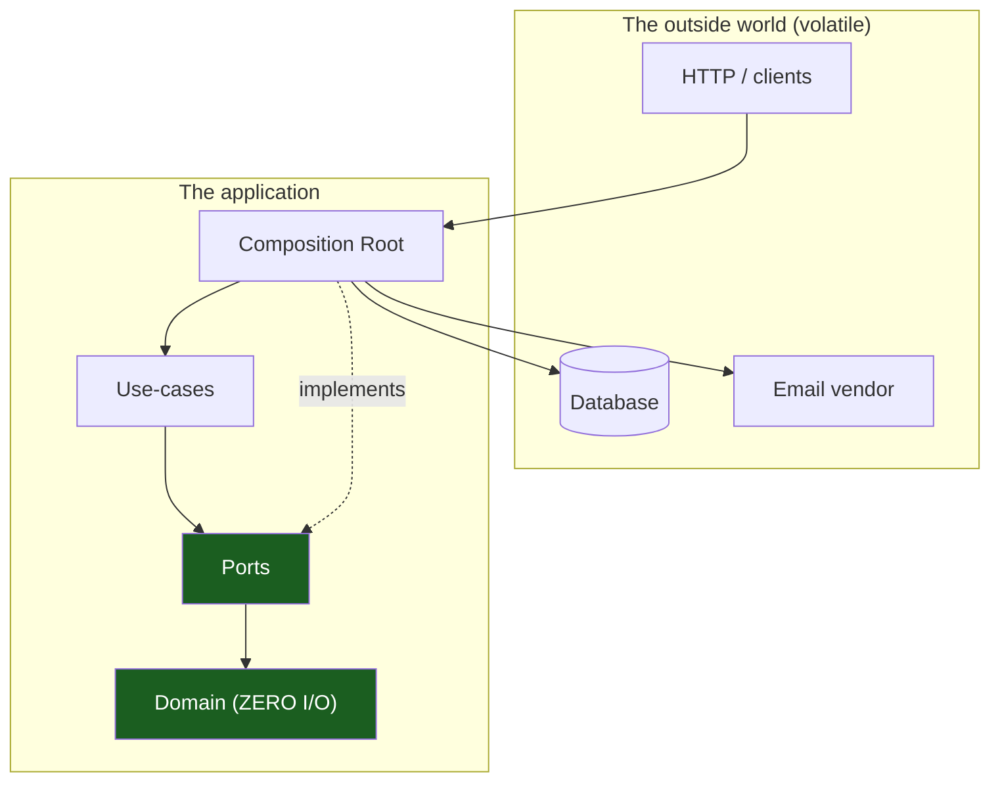
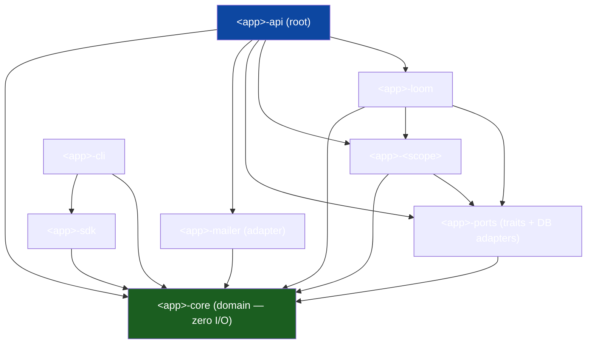
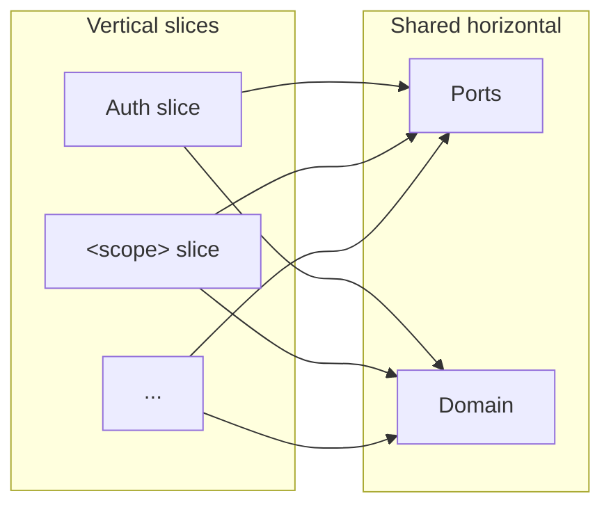
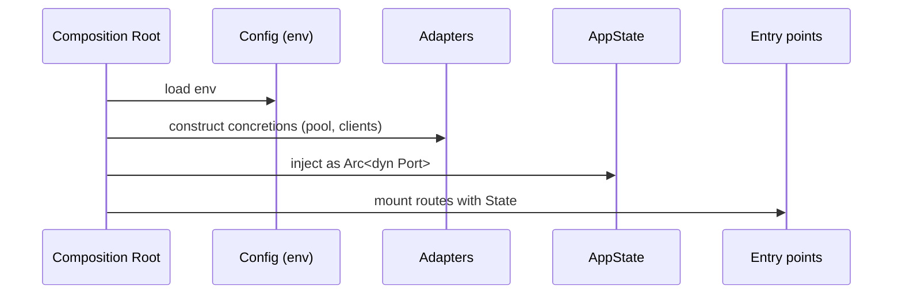

# Overview & Principles

The entry chapter. It states the one structural idea — **hexagonal (ports &
adapters) + vertical slicing, expressed as a crate-per-concern Cargo workspace**
— and the ~8 principles that follow. Generic; replace `<app>` with your project
and `<scope>` with a domain slice.

## 1. The problem this solves

A growing application accumulates two kinds of code that change for different
reasons:

- **Business rules** — what the product *means*. Change when the product changes.
- **Mechanisms** — how it *talks to the world* (DB, HTTP, queues, vendors).
  Change when infrastructure changes.

If tangled, every DB swap risks the rules and every rule change risks the
wiring. The architecture keeps them apart with one discipline: **dependencies
point inward, toward the business rules, never outward toward mechanisms.**



The green nodes never import the red ones.

## 2. The layers

| Ring | Knows about | Depends on | Volatility |
|------|-------------|------------|------------|
| **Domain** | Types, IDs, enums, errors, value objects | *nothing* | very low |
| **Ports** | Traits the domain/use-cases need from the world | Domain | low |
| **Use-cases** | One vertical slice each | Domain, Ports | medium |
| **Adapters + Root** | Concrete I/O; wiring | everything inward | high |

Constraint: **an inner ring may never name an outer ring.** No cycles.

### Worked example

A Rust 2024 Cargo workspace. Each crate is a node in the dependency graph;
`cargo` rejects cycles, so the rule is mechanically enforced.



Everything flows toward `<app>-core`. Nothing depends on `<app>-api`.

## 3. Vertical slicing on top of horizontal layers

Layering is *horizontal* (domain under ports under use-cases). **Vertical
slicing** cuts the other way: each use-case gets its own self-contained crate
that owns its slice end to end. A slice is "tall" (reaches from its public API
down to the domain) but "narrow" (one feature's logic).



Two slices share logic through the **domain** or a **port**, never by importing
each other. The orchestrator (`<app>-loom`) is the one slice allowed to call
other slices.

## 4. The core principles

### P1 — Dependencies point inward
Source dependencies only point toward more-stable code. Enforced by the Cargo
dependency graph: `<app>-core` has no internal deps; `<app>-api` has all of them.

### P2 — The domain has zero I/O
The innermost layer is pure: no DB, no network, no clock, no filesystem. If a
rule needs data from the world, it receives it as an argument. I/O crates like
`sqlx` are behind **optional features** (`<app>-core/sqlx`) so types can derive
DB traits without the domain performing I/O.

### P3 — Depend on traits, not concretions
A use-case states *what* it needs as a `#[async_trait]` port; it never names the
concrete `Pg*` adapter. The implementation is injected as `Arc<dyn Trait>` at
startup.

```rust
#[async_trait]
pub trait WidgetRepository: Send + Sync + 'static {
    async fn find(&self, id: WidgetId) -> Result<Option<Widget>>;
}
// use-case holds Arc<dyn WidgetRepository>, not PgWidgetRepository.
```

### P4 — One vertical slice per use-case
Each feature is a self-contained crate. New capability → new crate, wired in at
`<app>-api`.

### P5 — A single composition root wires everything
Exactly one place (`<app>-api`) knows every concrete type: it constructs
adapters, injects them into ports, builds `AppState`, mounts routes. Nothing
depends on it.



### P6 — Lean on compile-time guarantees
clippy `-D warnings` with `pedantic` + `nursery`; `unsafe_code = "forbid"`
workspace-wide; SQL **compile-time-checked** by sqlx against a committed
`.sqlx/` offline cache so CI builds without a live database.

### P7 — Reversible, paired migrations
Every `.up.sql` ships with its exact `.down.sql`. Schema and application evolve
together, both reviewable.

### P8 — Mockable ports → fast, isolated tests
Because use-cases depend on traits and the root injects implementations, tests
substitute in-memory fakes. A use-case is tested with no database and no network.

## 5. Runtime cooperation

Principles are about *source dependencies*. At runtime control flow crosses
outward — the root calls a use-case, which calls a port trait whose injected
adapter answers. The outward *call* is fine; an outward *import* is forbidden.
The trait is the seam.

## 6. Why a workspace of small crates

Modules rely on convention; a workspace makes the compiler enforce the rule.

**Do:** dependency rule becomes a compile error; public/private enforced at the
crate edge; incremental parallel builds; feature flags keep the domain I/O-free.

**Don't:** over-split (one crate per *concern*, not per file); add an edge just
for convenience; put I/O in the domain "just this once."

## See also

- [Crate topology](03-crate-topology.md)
- [Hexagonal architecture](01-hexagonal-architecture.md)
- [Dependency rules](04-dependency-rules.md)
- [Testing & CI](11-testing-and-ci.md)