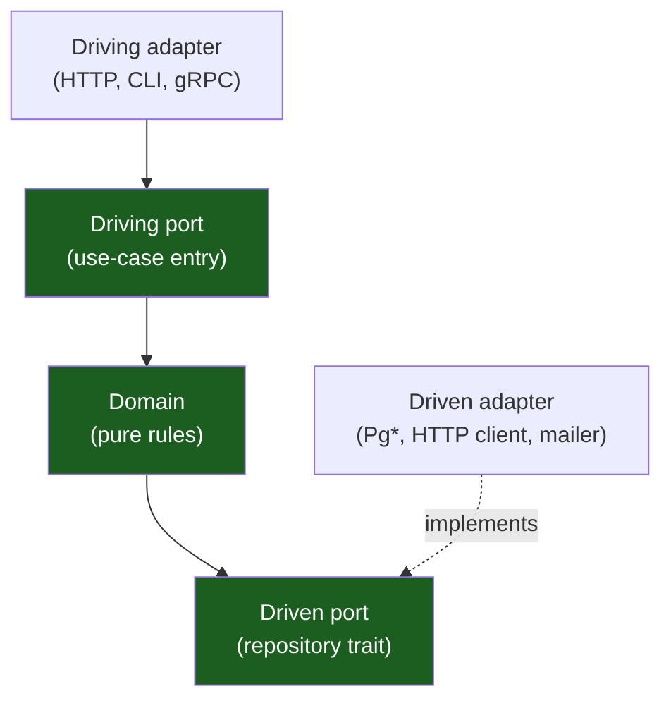
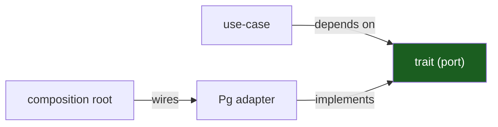

# Hexagonal Architecture (Ports & Adapters)

Generic ports-and-adapters guide, mapped onto a Rust crate workspace. The
pattern is language-neutral; the Rust realization uses `#[async_trait]` traits
held behind `Arc<dyn Trait>`.

## 1. The shape



- **Driving side** (left): things that call *into* the application — axum
  handlers, the CLI. They talk to a **driving port** (a use-case service).
- **Driven side** (right): things the application calls *out to* — Postgres, an
  email provider. They implement a **driven port** (a repository trait).

## 2. The domain core

Pure types + pure functions. No `async`, no `sqlx`, no HTTP. See
[`<app>-core`](03-crate-topology.md). One `Error` enum; every adapter converts
foreign errors into it at the boundary.

## 3. Driven ports (repository traits)

A port is an `#[async_trait]` whose signature is pure-domain: no `sqlx::Error`,
no `PgRow`, no `reqwest::Response`. The `Send + Sync + 'static` bound is what
makes `Arc<dyn Trait>` shareable across async tasks.

```rust
#[async_trait]
pub trait WidgetRepository: Send + Sync + 'static {
    async fn find(&self, id: WidgetId) -> Result<Option<Widget>>;
    async fn upsert(&self, widget: Widget) -> Result<Widget>;
}
```

## 4. Driven adapters

The concrete implementation (e.g. `PgWidgetRepository`) lives in
`<app>-ports/src/adapters/` and is referenced **only** by the composition root.
It maps foreign errors into the domain error inside the adapter:

```rust
fn map(e: sqlx::Error) -> Error {
    match e {
        sqlx::Error::RowNotFound => Error::NotFound,
        other => Error::Internal(other.to_string()),
    }
}
```

## 5. Driving ports + driving adapters

A driving port is the application's public API — a service struct with methods.
The driving adapter (axum handler) extracts the request, calls the service, and
serializes the response. The handler knows about HTTP; the service does not.

## 6. Dependency inversion

Without ports, a use-case would `use sqlx::PgPool` directly — coupled to
Postgres, untestable without a database. The port inverts the arrow: the
use-case depends on an abstraction it owns; the adapter depends on the same
abstraction to implement it. The composition root connects them.



## Do / Don't

- **Do** return pure-domain types from every port method.
- **Do** map foreign errors inside the adapter; never leak `sqlx::Error`.
- **Don't** return `PgRow` or `sqlx::QueryAs` from a trait method.
- **Don't** reference a `Pg*` adapter from a use-case crate — that's the root's
  job.

## See also

- [Crate topology](03-crate-topology.md)
- [Dependency rules](04-dependency-rules.md)
- [Persistence & migrations](08-persistence-and-migrations.md)