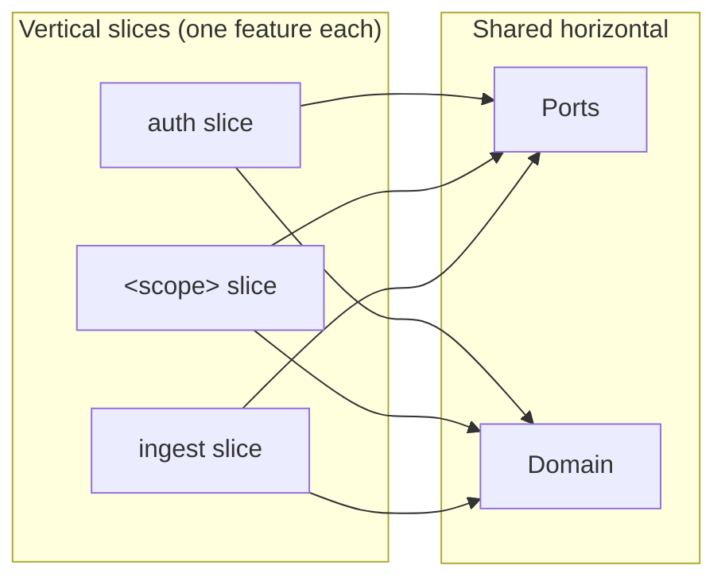
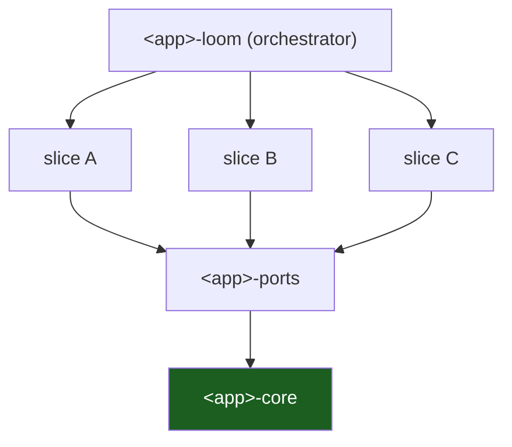

# Vertical Slicing

Feature-oriented vertical slices over a shared horizontal (domain + ports). Each
use-case is its own crate owning one flow end-to-end. A slice is a thin hexagon.

## 1. Horizontal layers + vertical cuts



Layering keeps mechanisms out of rules; slicing keeps features out of each
other. A new feature is a new slice — you add a crate, you don't thread changes
through a god-object.

## 2. What a slice owns

A slice crate (`<app>-<scope>`) owns:
- a `Service` struct holding `Arc<dyn ...Repository>` repos,
- the business rules for that one capability,
- its own `#[cfg(test)]` unit tests using the mock repos from `<app>-ports`.

It depends on `core` (types) + `ports` (traits) + any infra adapter it needs. It
does **not** depend on sibling slices.

```rust
#[derive(Clone)]
pub struct WidgetService {
    repo: Arc<dyn WidgetRepository>,
}
```

## 3. The orchestrator exception

One slice (`<app>-loom`) is the orchestrator and is *allowed* to depend on other
slices — it fans a request out across services and stitches results together.
Leaf slices stay independent; only the orchestrator composes them.



## 4. Sharing between slices

Two slices that need shared logic share it through the **domain** (`<app>-core`)
or behind a **port** (`<app>-ports/domain/`) — never by importing each other. If
two slices "need" each other, the shared thing belongs in a lower ring.

## 5. Adding a slice (recipe)

1. `crates/<app>-<scope>/` with a manifest inheriting `[lints] workspace = true`.
2. If it needs new storage: add a trait to `ports/domain/`, a `Pg*` adapter to
   `ports/adapters/`, a mock to `ports/mock/`; re-export from `ports/lib.rs`.
3. Write the `<Scope>Service`; unit-test with the mock.
4. Add the crate to root `[workspace] members` + `[workspace.dependencies]`.
5. Wire it into `AppState::from_env`; mount routes in `router::build`.
6. Add a paired migration; refresh `.sqlx/`; commit.
7. Run `just ci`.

## Do / Don't

- **Do** keep slices narrow: one capability per crate.
- **Don't** let a leaf slice import another leaf slice.
- **Don't** put cross-slice orchestration anywhere but `<app>-loom`.

## See also

- [Crate topology](03-crate-topology.md)
- [Playbooks — add a slice](12-playbooks.md)
- [Testing & CI](11-testing-and-ci.md)