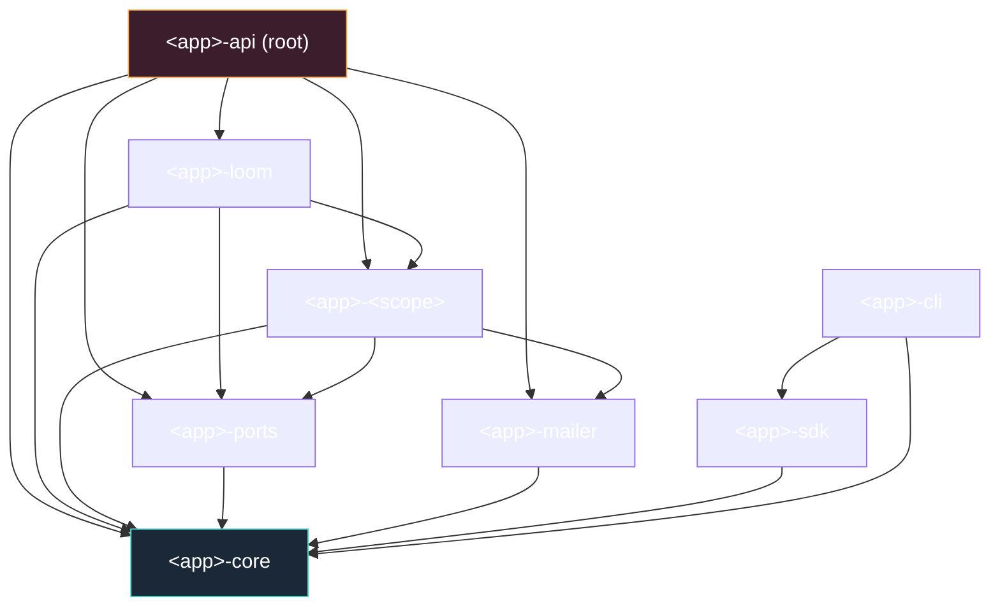

# Crate Topology & Workspace Layout

The crate taxonomy, the full dependency graph, and the role→crate map for a
hexagonal Rust workspace.

## 1. Six kinds of crate

| Kind | Crate | Role | Depends on |
|------|-------|------|------------|
| Domain | `<app>-core` | IDs, enums, value objects, errors; zero I/O | nothing |
| Ports | `<app>-ports` | Repository traits + `Pg*` adapters + mocks | `core` |
| Use-case slice | `<app>-<scope>` | One vertical capability | `core`, `ports`, infra |
| Orchestrator | `<app>-loom` | Fans out to other slices | `core`, `ports`, slices |
| Infra adapter | `<app>-mailer` | Wraps one external system | `core` |
| Composition root | `<app>-api` | Wires adapters into ports; mounts routes | everything inward |
| Client | `<app>-sdk`, `<app>-cli` | Typed client + CLI | `core` (+ `sdk`) |

## 2. The dependency graph

Arrows mean *depends on*; they only point inward or sideways to a sibling
adapter — never back outward, never in a cycle. `cargo` enforces this.

## 3. Crate-vs-module

A module within a crate relies on convention to keep the rule; a workspace of
crates makes the compiler enforce it. **One crate per concern, not per file.**
Public/private is enforced at the crate edge: a slice's internals can't leak into
a sibling. Incremental builds: touching one slice doesn't rebuild `core`.

## 4. The domain crate (`<app>-core`)

Pure. Typed IDs (newtype around `Uuid`), enums mirroring DB enums, value
objects, one `Error` enum, `Result<T>` alias. I/O crates behind optional
features (`sqlx`, `openapi`) so types can derive traits without the domain
doing I/O. Compiles in milliseconds; trivially unit-testable.

## 5. The ports crate (`<app>-ports`)

Three sibling modules:
- `domain/` — the port traits (`WidgetRepository`, …),
- `adapters/` — the `Pg*` implementations (the only place SQL lives),
- `mock/` — in-memory test doubles, gated behind `#[cfg(any(test, feature="mock"))]`.

Downstream code depends on the trait; only the composition root touches the
concrete adapter. Mocks ship inside `ports` so every downstream crate gets the
same test double for free.

## 6. The composition root (`<app>-api`)

The only crate that names concrete adapters. It opens the `PgPool`, constructs
each `Pg*` adapter, wraps it in `Arc`, hands it to the use-case services, stores
the lot in an `AppState` (all-`Arc`, cheap to clone), and mounts the axum router.
Two constructors:

- `AppState::from_env` — production wiring (pool, real adapters, run migrations).
- `AppState::with_repos` — test wiring (inject any `Arc<dyn Trait>`; no Postgres).

## 7. Client crates

`<app>-sdk` is a typed HTTP client mirroring the wire contract. `<app>-cli` is a
thin CLI on top of the SDK. Both depend on `core` for shared types.

## See also

- [Project skeleton](13-project-skeleton.md) — the copy-paste layout.
- [Dependency rules](04-dependency-rules.md) — allowed/forbidden edges.
- [Hexagonal architecture](01-hexagonal-architecture.md)