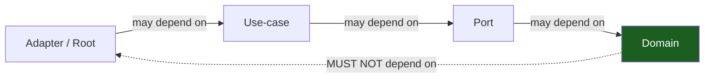

# Dependency Rules & Boundaries

The dependency rule in depth: allowed vs forbidden edges, and how to enforce it.

## 1. The rule

**Source-code dependencies only point toward more-stable code.** An outer ring
may name an inner one; an inner ring must never name an outer one. No cycles.

## 2. Allowed edges

| From | To | OK? |
|------|----|----|
| `<app>-api` | any crate | yes (root knows everything) |
| `<app>-loom` | slices, ports, core | yes (orchestrator) |
| `<app>-<scope>` | ports, core, infra adapters | yes |
| `<app>-ports` | core | yes |
| `<app>-mailer` | core | yes |
| `<app>-sdk` / `-cli` | core (+ sdk) | yes |

## 3. Forbidden edges

| From | To | Why |
|------|----|----|
| `<app>-core` | anything in the workspace | domain is zero-I/O |
| `<app>-<scope>` (leaf) | another leaf slice | slices stay independent |
| `<app>-ports` (trait) | `<app>-ports` (adapter) at the *consumer* | consumers depend on the trait, not the adapter |
| any crate | `<app>-api` | nothing depends on the root |

## 4. Enforcement

1. **Cargo dependency graph.** A cycle fails to compile. Add a dependency edge
   only via `[dependencies]` in the member `Cargo.toml`; if the edge is
   forbidden, the graph makes it obvious.
2. **`Arc<dyn Trait>` at the seam.** A use-case stores `Arc<dyn WidgetRepository>`,
   not `PgWidgetRepository`. The field type is the contract; the value is the
   implementation chosen at the root.
3. **clippy + `unsafe_code = "forbid"`.** Workspace lints inherit to every
   member. `-D warnings` with `pedantic` + `nursery` keeps the code idiomatic.
4. **Review.** The graph catches structural violations; review catches the
   "depends on trait but reaches for the adapter anyway" smell.

## 5. Domain invariants the structure protects

- **One error type.** Every port method returns `core::Result<T>`; adapters map
  foreign errors inward. Callers never see `sqlx::Error`.
- **One normalization point per concern.** If a value is normalized (a
  distribution summing to 1.0, a currency in cents), it happens in exactly one
  slice.
- **SQL lives only in `ports/adapters/`.** A `query!` anywhere else is a leak.
- **Paired migrations.** Every `.up.sql` has a `.down.sql`.
- **No `unsafe`.** `unsafe_code = "forbid"` is a hard wall.

## Do / Don't

- **Do** depend on the trait (`Arc<dyn Foo>`), so tests inject a mock.
- **Do** add a new arrow only when the coupling is real and permanent.
- **Don't** let a use-case import a `Pg*` adapter.
- **Don't** put I/O in `<app>-core` "just this once."

## See also

- [Crate topology](03-crate-topology.md)
- [Hexagonal architecture](01-hexagonal-architecture.md)
- [Testing & CI](11-testing-and-ci.md)