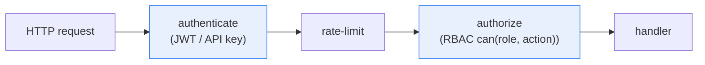

# Authentication & Authorization Architecture

Generic auth subsystem reference, Rust-idiomatic. Replace the `<scope>` user
entity with your own identity model.

## 1. Identity vs credentials

An **identity** (`User`) is who you are. **Credentials** (password hash, OAuth
identity, API key) are how you prove it. Store them in separate tables/repos so
a credential compromise rotates without rewriting the identity.

## 2. Password hashing

`argon2` with a tuned cost. Hash at the boundary; the domain only sees "verify
returns bool." Never log or serialize a hash.

## 3. JWT access + rotating refresh tokens

- **Access token**: short-lived JWT (`jsonwebtoken`), signed with a symmetric
  key. Carries `sub`, `role`, `exp`.
- **Refresh token**: long-lived, stored as a hash server-side. **Rotation**:
  each use issues a new refresh + revokes the old. **Reuse detection**: if an
  already-revoked refresh is presented, revoke *all* sessions for that user
  (token-theft signal).
- **IP binding**: optionally bind a session to the issuing IP; a mismatch forces
  re-auth.

```mermaid
sequenceDiagram
    participant C as Client
    participant W as Warden (auth slice)
    participant S as SessionRepository
    C->>W: login (email, password)
    W->>W: verify argon2 hash
    W->>S: create session + refresh hash
    W-->>C: access + refresh
    C->>W: refresh (old refresh)
    W->>S: rotate; revoke old; issue new
    W-->>C: new access + refresh
    Note over C,W: reuse of revoked refresh → revoke all sessions
```

## 4. OIDC (OAuth2)

`oauth2` crate. The auth slice stores an `OAuthIdentity` per provider; the
callback exchanges a code for tokens and looks up / creates the local identity.
Keep provider specifics in the adapter, not the domain.

## 5. HMAC API keys

For machine-to-machine: a key id + an HMAC-SHA256 signature over the request.
The warden verifies the signature and looks up the key's scopes. `hmac` crate.

## 6. The pipeline: authenticate → rate-limit → authorize



Implemented as axum middleware / extractors. A failed step short-circuits with
the right HTTP status (401 / 429 / 403).

## 7. RBAC

A `can(role, action) -> bool` matrix in `<app>-core` (pure, unit-tested). Roles
and actions are closed enums mirroring DB enums. Authorize at the handler using
the role carried on the authenticated principal.

## 8. WebSocket query-token auth

For realtime endpoints, accept the access token as a query param on the upgrade
request, verify it once, then drop the query from logs. See
[Realtime & streaming](09-realtime-and-streaming.md).

## 9. Threat model (generic)

- Password reuse / weak hash → argon2 + breached-password check.
- Refresh-token theft → rotation + reuse-revoke-all + IP binding.
- JWT replay → short access TTL + `jti` blacklist for revocation.
- API-key leak → scoped keys, redacted `Debug`, rotation.
- XSS/CSRF → `SameSite` cookies, no token in localStorage for browser clients.

## Do / Don't

- **Do** hash with argon2; verify in constant time.
- **Do** rotate refresh tokens; detect reuse.
- **Don't** log tokens, keys, or hashes.
- **Don't** put provider-specific claims in the domain — keep them in the adapter.

## See also

- [Design patterns](05-design-patterns.md)
- [Request lifecycle](07-request-lifecycle.md)
- [Error & observability](10-error-config-observability.md)