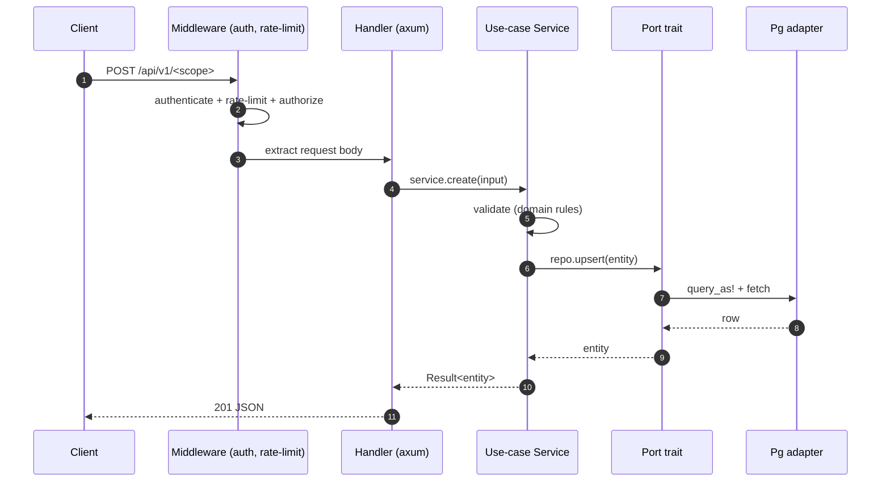
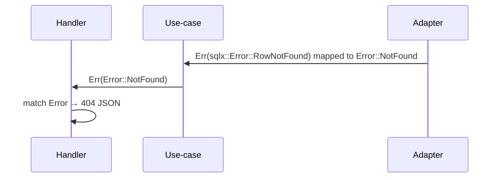

# Request Lifecycle

End-to-end trace of an HTTP request through a hexagonal axum workspace.

## 1. The path

## 2. The layers crossed

1. **Transport** — axum `serve` accepts the TCP connection.
2. **Middleware** — `tower-http` (tracing, CORS) + auth/rate-limit extractors.
3. **Extractor** — axum `Json<T>` deserializes the body into a request DTO.
4. **Handler** — validates at the HTTP boundary, maps to a domain input, calls
   the use-case service. Maps `core::Error` to an HTTP status.
5. **Use-case** — business rules over `Arc<dyn Trait>` repos. No HTTP types.
6. **Port** — the trait call; pure-domain signature.
7. **Adapter** — the `Pg*` adapter runs `query_as!` (compile-time checked),
   maps `sqlx::Error` → `core::Error`, returns a domain entity.

## 3. Error path

The handler is the **only** place that knows about HTTP status codes. The
use-case and adapter speak `core::Error` exclusively. One `match` in the handler
maps the domain error enum to responses.

## 4. Read vs write

- **Read** (`GET`): handler → service → `repo.find` → entity → serialize. No
  mutation; safe to cache.
- **Write** (`POST/PUT`): handler → service → validate → `repo.upsert` → entity.
  The adapter wraps the write in a transaction if it spans multiple statements.

## See also

- [Hexagonal architecture](01-hexagonal-architecture.md)
- [Error & observability](10-error-config-observability.md)
- [Persistence & migrations](08-persistence-and-migrations.md)