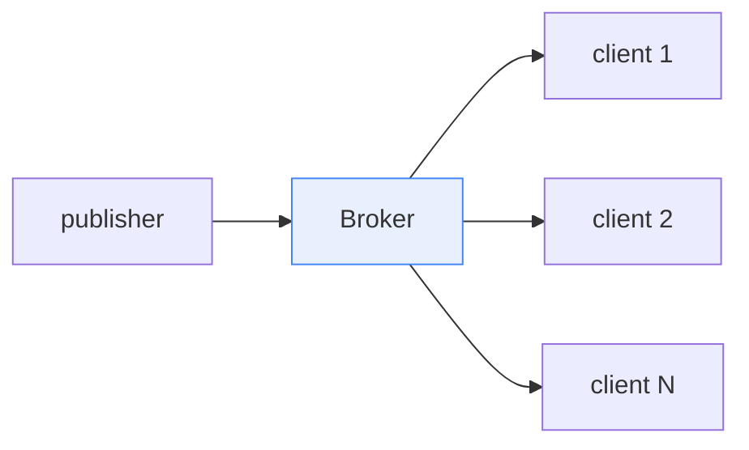
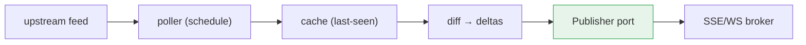

# Realtime & Streaming

Push patterns for a Rust backend: SSE fan-out, WebSocket sessions, and a
poll→cache→publish gateway. Adapt to whatever realtime surface `<app>` needs;
drop what you don't.

## 1. SSE fan-out broker

A `<scope>` slice owns a broker: clients subscribe to a topic, the slice
broadcasts deltas. Each client gets its own `mpsc` receiver; the broker holds a
`DashMap<topic, Vec<Sender>>`. axum streams `Sse<ReceiverStream<...>>`.

- **Backpressure:** bounded channels; a slow consumer is dropped after N pending.
- **Batching:** coalesce deltas within a small window before broadcast.

## 2. WebSocket sessions

For bidirectional realtime, axum `ws` upgrade. Auth: verify the access token on
the upgrade request (query param), then drop the query from logs. A
`Connection` manages ping/pong + a heartbeat; the broker routes per-topic.

## 3. Poll → cache → publish gateway

A gateway polls an upstream feed on a schedule, diffs against a cache, and
publishes only deltas to the broker. The gateway is a port (`GeoPublisher`)
with a `NoopPublisher` double so a full poll cycle runs in a test while dropping
every delta.

## 4. Capability negotiation

Clients declare capabilities on connect (max batch, supported encodings). The
broker tailors the payload per subscriber. Keep capability logic in the slice,
not the transport.

## Do / Don't

- **Do** use a Null-Object publisher so poll cycles are hermetic in tests.
- **Do** bound every channel; a slow consumer must not stall the broker.
- **Don't** hit the real upstream feed in CI — point the poller at a mock server.

## See also

- [Design patterns](05-design-patterns.md) — Observer + Null Object, Caching Proxy
- [Auth architecture](06-auth-architecture.md) — WebSocket query-token auth
- [Testing & CI](11-testing-and-ci.md)