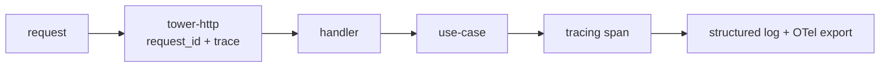

# Errors, Configuration & Observability

One domain error type mapped to HTTP, typed config from env with
validate-on-boot, and structured observability.

## 1. One domain error

`<app>-core` defines one `Error` enum. Every adapter maps foreign errors into it
at the boundary; callers never see `sqlx::Error` or `reqwest::Error`.

```rust
#[derive(Debug, thiserror::Error)]
pub enum Error {
    #[error("not found")] NotFound,
    #[error("invalid input: {0}")] Invalid(String),
    #[error("unauthorized")] Unauthorized,
    #[error("upstream {service}: {detail}")] Upstream { service: &'static str, detail: String },
    #[error("internal: {0}")] Internal(String),
}
```

## 2. Mapping to HTTP

The handler is the only place that knows HTTP status codes. One `match` maps the
domain error to a response:

```rust
impl axum::response::IntoResponse for Error {
    fn into_response(self) -> axum::Response {
        let (code, msg) = match self {
            Error::NotFound => (404, "not found"),
            Error::Invalid(m) => (400, "invalid input"),
            Error::Unauthorized => (401, "unauthorized"),
            Error::Upstream { .. } => (502, "upstream error"),
            Error::Internal(_) => (500, "internal error"),
        };
        (code, msg).into_response()
    }
}
```

Never leak internal detail (`sqlx` text, stack) to the client; log it server-side
with a request id and return a generic message.

## 3. Typed config from env

Load env into a typed `Config` struct at boot; **validate on boot** — fail fast
if a required var is missing or a URL is malformed. `serde` + `envy` or a
hand-rolled loader. No config reads after startup; pass `Arc<Config>` through
`AppState`.

```rust
#[derive(Debug, Deserialize)]
pub struct Config {
    pub database_url: String,
    pub bind: String,
    pub jwt_secret: String,
}
impl Config {
    pub fn from_env() -> anyhow::Result<Self> { /* ... */ }
}
```

## 4. Observability

- **`tracing` + `tracing-subscriber`** with `env-filter`. Structured spans;
  every request gets a request id injected by `tower-http::request_id`.
- **`opentelemetry`** exporter for distributed tracing when you outgrow stdout.
- **Health / readiness:** `/healthz` (process alive) and `/readyz` (pool
  connected + migrations applied). The load balancer probes `/readyz`.



## Do / Don't

- **Do** map foreign errors inward at the adapter boundary.
- **Do** validate config once at boot.
- **Don't** leak internal error text to clients.
- **Don't** read env vars mid-request — pass `Arc<Config>`.

## See also

- [Request lifecycle](07-request-lifecycle.md)
- [Testing & CI](11-testing-and-ci.md)