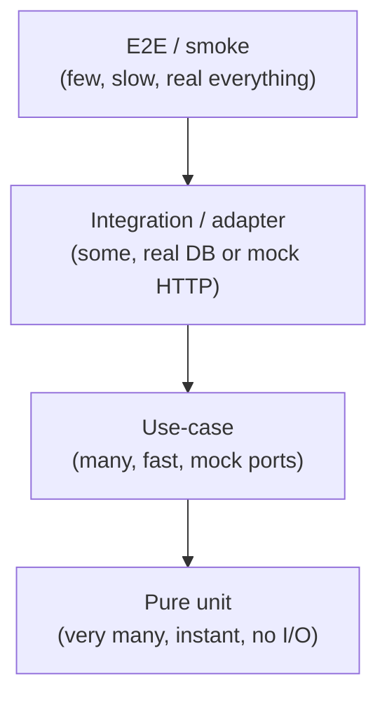
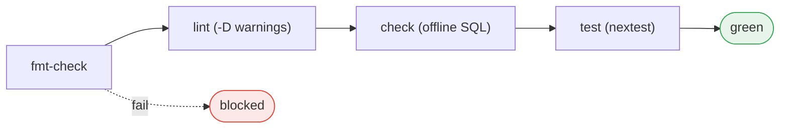

# Testing Strategy & CI

The inward-pointing dependency graph makes testing cheap. Generic test pyramid,
then the `just ci` gate.

## 1. Testability is a property of the dependency graph

Three architectural choices make a layered codebase testable:
1. The domain depends on nothing (pure functions).
2. Every outbound collaborator is a port (`Arc<dyn Trait>`), not a concrete
   client — so a test swaps in an in-memory double.
3. Wiring happens in one place (the composition root) — production wires the
   adapter, a test wires the double.



## 2. Layer 1 — Pure unit

Pure functions beside the code in `#[cfg(test)]`. No setup, no mocks. Edge cases
live here (empty input, normalization, overflow clamps). This is the wide base.

## 3. Layer 2 — Use-case tests: swap a mock at the port

Construct the real `Service` with `Arc::new(MockRepository)`; assert on the
return value and recorded side effects. Pin time and randomness by passing them
in.

```rust
#[tokio::test]
async fn create_rejects_blank_name() {
    let svc = WidgetService::new(Arc::new(MockWidgetRepository::default()));
    assert!(svc.create("  ", WidgetKind::Cog).await.is_err());
}
```

- Write mocks by hand (`Mutex<State>`); shorter than a mocking macro.
- Use a Null-Object double (`NoopMailer`) for collaborators you don't care about.
- Don't spin up Postgres to test orchestration branches.

## 4. Layer 3 — Integration / adapter tests

Verify the seam to the real world:
- **DB:** run `Pg*Repository` against a Postgres container (`testcontainers`);
  assert round-trips and the error mapping (`RowNotFound → NotFound`).
- **HTTP:** point the real client at a local mock server (`wiremock`); assert
  request shape + error mapping. Never hit the real provider in CI.

Reset state between tests (transaction-per-test or truncate).

## 5. Layer 4 — E2E / smoke

Boot the router over an `AppState`; hit `/healthz` + a representative route.
For route/middleware tests that don't care about persistence, use
`AppState::with_repos(...)` with mocks — hermetic and fast.

## 6. Compile-time tests

- **Type system:** newtype IDs make swapped ids unrepresentable.
- **sqlx offline check:** the `.sqlx/` cache verifies SQL against the schema at
  build time; CI builds without a database.

## 7. The CI gate

`just ci` mirrors CI locally:

```
just ci == fmt-check + lint + check + test
```

- `fmt-check` → `cargo fmt --all -- --check` (hard gate).
- `lint` → `cargo clippy --workspace --all-targets --all-features -- -D warnings`
  with `pedantic` + `nursery` + `unsafe_code = "forbid"`. Code that merely
  compiles can still fail lint.
- `check` → `cargo check --workspace --all-targets --all-features` (hermetic via
  `.sqlx/`).
- `test` → `cargo nextest run --workspace` (parallel, per-test isolation).
- `doc` → `cargo doc --workspace --no-deps`.
- `just audit` (optional) → `cargo audit` + `cargo deny check` + `cargo machete`.

The local task and the CI job are the **same** command. Run `just ci` before
declaring work complete.



## 8. Where does my test go?

- Behavior touches I/O? → Is it behind a port? → mock at the port (Layer 2).
- Testing the I/O itself? → adapter test vs container / mock server (Layer 3).
- Testing the whole assembly? → smoke over the router (Layer 4).
- No I/O at all? → pure unit (Layer 1).

If a test is hard to write, the architecture is telling you something: a missing
port, or a function doing three jobs.

## See also

- [Crate topology](03-crate-topology.md)
- [Dependency rules](04-dependency-rules.md)
- [Persistence & migrations](08-persistence-and-migrations.md)