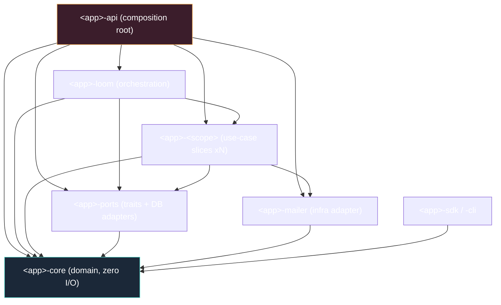

# Project Skeleton (Template)

A ready-to-copy starting point. Everything here is generic — rename `<app>` to
your project, drop the crates you don't need, and you have a compiling skeleton
with the right invariants baked in (`unsafe` forbidden, `-D warnings` linting,
mockable repositories) on day one.

> The literal `skeleton/` lives next to this `docs/` tree. This chapter is the
> annotated guide to it.

## 1. The shape you are building toward



## 2. Directory layout

```text
skeleton/
├── Cargo.toml                 # [workspace] — members, deps, lints
├── rust-toolchain.toml        # pin 1.85
├── .sqlx/                     # committed offline query cache
├── migrations/                # NNNN_name.up.sql + .down.sql pairs
├── justfile                   # ci + migrate-add + sqlx-prepare
├── .github/workflows/ci.yml   # mirrors `just ci`
└── crates/
    ├── <app>-core/            # domain — depends on nothing
    │   └── src/lib.rs
    ├── <app>-ports/           # traits + Pg* adapters + mocks
    │   └── src/{lib.rs, domain/, adapters/, mock/}
    ├── <app>-widgets/         # example use-case slice
    │   └── src/lib.rs
    ├── <app>-mailer/          # infra adapter (email)
    │   └── src/lib.rs
    ├── <app>-loom/            # orchestration slice
    │   └── src/lib.rs
    ├── <app>-api/             # composition root
    │   └── src/{main.rs, state.rs, router.rs}
    ├── <app>-sdk/             # typed client
    │   └── src/lib.rs
    └── <app>-cli/             # CLI on top of the SDK
        └── src/main.rs
```

Conventions:
1. **One adapter family per `adapters/<thing>_pg.rs`**, mirroring its trait in
   `domain/<thing>_repository.rs`. Symmetry makes "where does this live?"
   answerable without grep.
2. **Mocks ship inside `ports`**, gated behind a `mock` feature, so every
   downstream crate gets the same test double for free.

## 3. Root `Cargo.toml`

The keystone. Declares members, hoists every third-party version into
`[workspace.dependencies]` (so members write `dep = { workspace = true }`), and
turns on the strict lint posture in `[workspace.lints]`.

Key lint posture:
- `unsafe_code = "forbid"` — a hard wall no `#[allow]` can reopen.
- `pedantic` + `nursery` at `warn`, with `clippy ... -D warnings` in CI: code
  that merely compiles can still fail the build.
- `priority = -1` so broad groups go on first; targeted `allow`s win above them.
- `resolver = "3"` (edition-2024 resolver).

Each member manifest is tiny: `[package]` inheriting workspace fields, `[lints]
workspace = true`, and `[dependencies]` referencing `workspace = true`.

## 4. The domain crate (`<app>-core`)

Pure: typed IDs (newtype around `Uuid::now_v7()`), enums mirroring DB enums,
value objects, one `Error` enum, `Result<T>` alias. I/O crates behind optional
features. See `skeleton/crates/<app>-core/src/lib.rs`.

## 5. The ports crate (`<app>-ports`)

Three modules: `domain/` (traits), `adapters/` (Pg impls — the only place SQL
lives), `mock/` (in-memory doubles, feature-gated). See
`skeleton/crates/<app>-ports/src/`.

## 6. A use-case slice (`<app>-widgets`)

A `Service` holding `Arc<dyn Trait>` repos; a small business API; unit tests
with the mock. See `skeleton/crates/<app>-widgets/src/lib.rs`.

The orchestrator (`<app>-loom`) is the same pattern, allowed to call other
slices.

## 7. The composition root (`<app>-api`)

`AppState` (all-`Arc`, cheap to clone) with `from_env` (production: pool →
migrations → concrete adapters → services) and `with_repos` (test: inject any
`Arc<dyn Trait>`). `router::build` mounts routes. `main.rs` boots it. See
`skeleton/crates/<app>-api/src/`.

## 8. Adding a new slice (repeatable recipe)

See [Playbooks §2](12-playbooks.md).

## See also

- [Crate topology](03-crate-topology.md)
- [Hexagonal architecture](01-hexagonal-architecture.md)
- [Testing & CI](11-testing-and-ci.md)