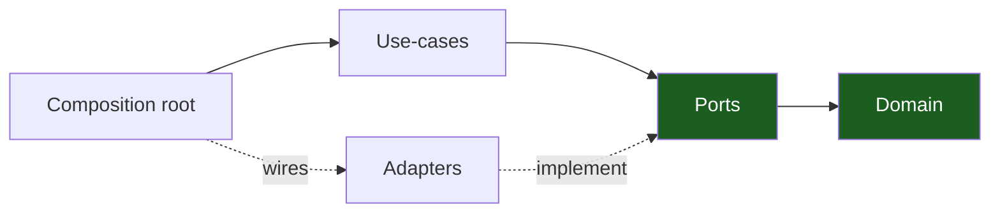

# Backend Rust Architecture Handbook

A **generic, reusable** reference for building a Rust backend with **hexagonal
architecture (ports & adapters) + vertical slicing**, realized as a
**crate-per-concern Cargo workspace**. Every chapter teaches the pattern
abstractly first, then shows a worked example (`### Worked example`) so you can
lift the structure into any project. Replace `<app>` with your project name and
`<scope>` with your domain slice name throughout.

> 15 chapters · adapted to Rust 2024 idioms (traits, axum, sqlx, clippy).

## The one rule

**Dependencies point inward.** The domain knows nothing about I/O; the
composition root knows about everything and wires it together. Everything else
makes that rule cheap to follow and hard to break. See
[Dependency Rules](04-dependency-rules.md).

## Start here

New? Read [00 — Overview & Principles](00-overview-and-principles.md), then
[01 — Hexagonal Architecture](01-hexagonal-architecture.md) and
[03 — Crate Topology](03-crate-topology.md). Starting a fresh project? Jump to
[13 — Project Skeleton](13-project-skeleton.md) and
[12 — Playbooks](12-playbooks.md).

## Contents

| # | Chapter | What it covers |
| --- | --- | --- |
| 00 | [Overview & Principles](00-overview-and-principles.md) | The one idea + 8 principles + chapter map |
| 01 | [Hexagonal Architecture](01-hexagonal-architecture.md) | Ports & adapters, driving/driven ports, dependency inversion |
| 02 | [Vertical Slicing](02-vertical-slicing.md) | One use-case per crate over a shared domain + ports horizontal |
| 03 | [Crate Topology](03-crate-topology.md) | Crate taxonomy, the dependency graph, role→crate map |
| 04 | [Dependency Rules](04-dependency-rules.md) | Allowed/forbidden edges, enforcement via Cargo + clippy |
| 05 | [Design Patterns](05-design-patterns.md) | Repository, Composition Root, Strategy, Newtype, Proxy, etc. |
| 06 | [Auth Architecture](06-auth-architecture.md) | Password hashing, JWT access/refresh, OIDC, HMAC keys, RBAC |
| 07 | [Request Lifecycle](07-request-lifecycle.md) | HTTP request through transport→middleware→handler→use-case→port→adapter |
| 08 | [Persistence & Migrations](08-persistence-and-migrations.md) | Repository trait/adapter, compile-time-checked SQL, `.sqlx` cache, up/down pairs |
| 09 | [Realtime & Streaming](09-realtime-and-streaming.md) | SSE fan-out, WebSocket sessions, poll→cache→publish |
| 10 | [Errors, Config & Observability](10-error-config-observability.md) | One domain error → HTTP, typed config from env, tracing |
| 11 | [Testing & CI](11-testing-and-ci.md) | Test pyramid, mock ports, nextest, the `just ci` gate |
| 12 | [Playbooks](12-playbooks.md) | Bootstrap, add a slice, add an adapter, ship a migration, expose an endpoint |
| 13 | [Project Skeleton](13-project-skeleton.md) | Copy-paste workspace template |
| 14 | [Glossary](14-glossary.md) | Every architectural term defined |

## How to apply this to a new project

1. Copy the workspace layout from [Project Skeleton](13-project-skeleton.md).
2. Put your types and rules in the **domain** crate (`<app>-core`, no I/O).
3. Declare what you need from the world as **port traits** (`<app>-ports/domain/`);
   implement them as **adapters** wired only at the **composition root**.
4. Add each feature as a **vertical slice** (one use-case crate `<app>-<scope>`).
5. Keep the [dependency rule](04-dependency-rules.md) green; let the build graph
   enforce it.